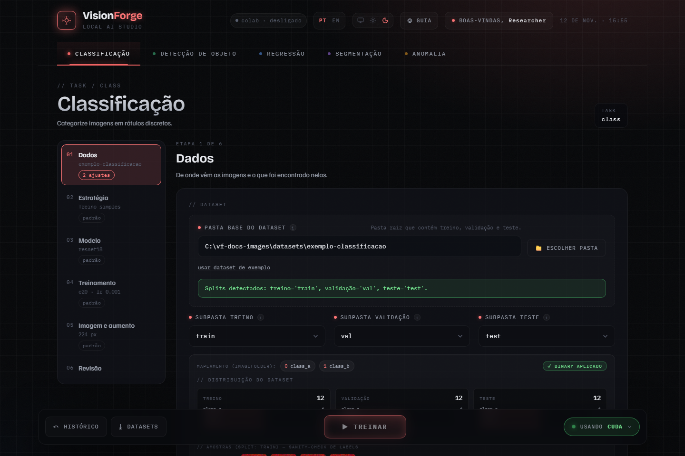
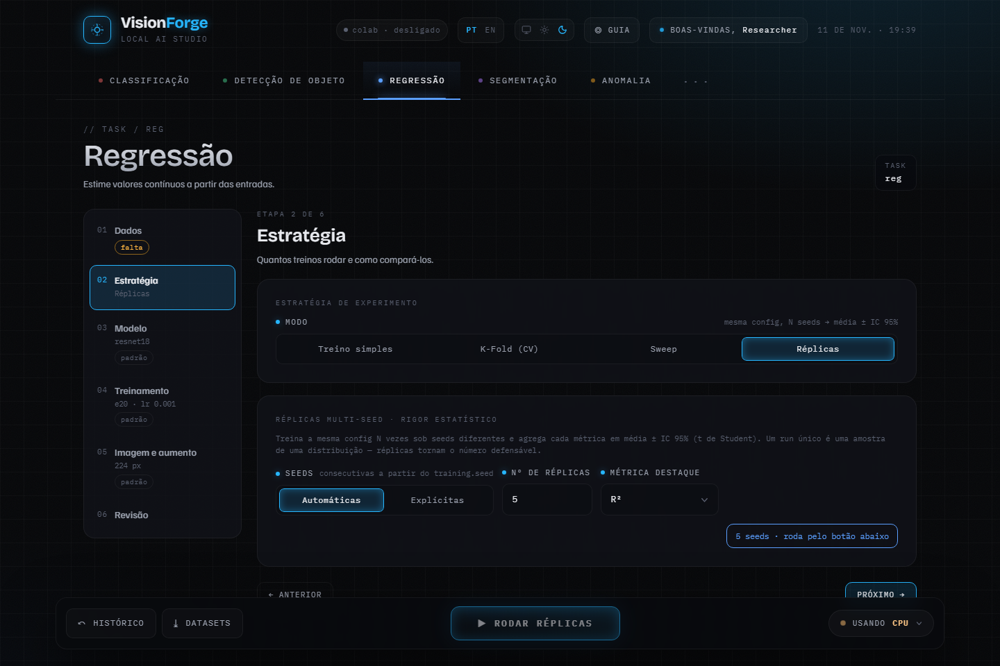

# VisionForge

[](https://github.com/marcus-vreis/VisionForge/actions/workflows/ci.yml)
[](https://github.com/marcus-vreis/VisionForge/blob/main/LICENSE)
[](https://doi.org/10.5281/zenodo.23425765)

**Train, compare and defend computer-vision models on your own GPU.**
Five task families in one local-first interface, without notebooks — it runs on your machine; nothing leaves it unless you ask for it (datasets, Colab and exporters are opt-in, with a local preview).

> 🇧🇷 **Este README também está em português** — [role até a versão em
> português](#português-pt-br).



## Install

You need **Python 3.12+** and about five minutes. Nothing else — the published
package already carries the built interface.

A step-by-step guide per system (Windows, Linux, macOS), with getting Python
itself and the usual errors, is in [`docs/INSTALL.md`](https://github.com/marcus-vreis/VisionForge/blob/main/docs/INSTALL.md) (Portuguese).
On a Mac: Apple Silicon only (PyTorch has no Intel-Mac builds since 2.3),
training runs on the CPU, and `doctor --fix` is not needed.

```bash
mkdir my-research && cd my-research
python -m venv .venv
.venv\Scripts\activate
```

On Linux or macOS the last line is `source .venv/bin/activate` instead.

```bash
pip install visionforge-studio
```

Now let VisionForge look at your machine and install the matching PyTorch build
— it reads your GPU driver, names the wheel you need, and installs it after you
answer `y`:

```bash
visionforge doctor --fix
```

That is the whole install. Start the interface:

```bash
visionforge gui
```

It opens on <http://127.0.0.1:8000>. The first screen asks your name and offers
a short guided tour of the interface.

<details>
<summary>Why PyTorch is installed separately</summary>

Its build has to match your hardware, and no dependency resolver can choose
between the CPU and CUDA wheels for you — on Windows, PyPI only carries the CPU
one, so that is what a plain install brings. `doctor --fix` replaces it with
the build your driver calls for.

Already know you want CUDA? Install torch **first**, from the PyTorch index, and
the package after — that skips downloading the CPU build at all:

```bash
pip install torch torchvision --index-url https://download.pytorch.org/whl/cu128
pip install visionforge-studio
```

Available in place of `cu128`: `cu118` · `cu121` · `cu124` · `cu126` · `cpu`.
`cu128` is the broadest — it spans Turing (sm_75) through Blackwell, and is the
only one that runs on an RTX 50-series card at all.

To update later, `pip install --upgrade visionforge-studio` — it keeps the
torch you have.

**On PyPI the distribution is `visionforge-studio`** — the bare `visionforge`
name belongs to an unrelated project. The import name, the CLI command and the
project itself are still `visionforge`.

</details>

<details>
<summary>What comes with it</summary>

Everything the five tasks need is in that one install — the YOLO and RT-DETR
detection backends, the extra `timm` backbones, Optuna-guided sweeps,
TensorBoard scalars, and the Roboflow / Kaggle / Hugging Face dataset
downloaders. They used to be optional extras; the split cost more than it
saved, and they add about 83 MB against the gigabytes PyTorch already pulls.

Choose the PyTorch build for your hardware. The optional tracking and
export integrations below are on `development` (**next release**): for local
MLflow tracking, install `visionforge-studio[mlflow]` and enable MLflow in the
profile picker. From the directory where the GUI started, run
`mlflow ui --backend-store-uri sqlite:///outputs/mlflow/mlflow.db` to inspect
training runs of every task, epoch metrics and the final `run.json`; if an export
fails, open the run in History to retry it. To follow them on
Weights & Biases, install `visionforge-studio[wandb]`, turn W&B on in the
profile picker and save an API key there; runs go to a private project. To push
a run's checkpoint, model card and metrics to a private Hugging Face Hub
repository, install `visionforge-studio[hub]`, save a write token in the
profile and review the local preview in History before sending
([`docs/gui/hugging-face-hub.md`](https://github.com/marcus-vreis/VisionForge/blob/main/docs/gui/hugging-face-hub.md)).
To cite a run by DOI, open it in History and create a Zenodo draft: the
bundle goes up without this machine's paths, and you fill in authors and
license and publish on Zenodo. To keep runs next to your code, send the
report to a private GitHub repository: one folder per run, without weights.
To version the weights with git, open the run in History and version it
with DVC in a repository on this computer (`visionforge-studio[dvc]`):
`dvc metrics show` and `dvc plots show` then compare the runs.

</details>

<details>
<summary>Running with Docker</summary>

From a repository checkout, [`Dockerfile`](https://github.com/marcus-vreis/VisionForge/blob/main/Dockerfile) and
[`docker-compose.yml`](https://github.com/marcus-vreis/VisionForge/blob/main/docker-compose.yml) build the React SPA in Stage 1 and bake Python 3.13,
PyTorch (`CUDA_TAG=cu128` by default, or `VARIANT=cpu` on `ubuntu:22.04`) and
VisionForge into Stage 2:

```bash
docker compose up                 # NVIDIA GPU (requires driver + nvidia-container-toolkit)
docker compose --profile cpu up   # CPU-only image
```

`./datasets` is mounted read-only (`/work/datasets:ro`) and `./outputs`,
`./user_models` and `./user_tasks` are mounted under `/work`. Inside the
container (`VISIONFORGE_CONTAINER=1`, `uid 1000`), type the mounted path (such
as `/work/datasets/my_dataset`) in the dataset field. See
[`docs/dev/DOCKER.md`](https://github.com/marcus-vreis/VisionForge/blob/main/docs/dev/DOCKER.md).

</details>

## First run

Point the dataset picker at a folder, pick a task tab, press *Train*. If you
have no dataset yet, the **⤓ datasets** button downloads one (CIFAR-10, for
example) already in the layout the task expects.

The interface is available in English and Portuguese (PT/EN switch in the header),
with a light, dark or automatic theme.

Every task is configured in the same six steps — Data, Strategy, Model,
Training, Image and augmentation, and Review. *Train* unlocks on the Review
step, and the experiment name is suggested from the configuration.

In the **Datasets** panel, the **Explore** tab (**next release**, on
`development`) inspects classification (`ImageFolder`) and detection (YOLO)
datasets before training: class and split counts, a paginated thumbnail gallery
(with bounding boxes drawn for detection), and a background integrity scan for
unreadable files and exact SHA-256 duplicates across splits. From the same tab,
you can incorporate new images, merge two datasets, resplit with the test set
locked by default, or convert between YOLO and COCO — always writing a new
sibling folder with `visionforge_dataset.json` and leaving the original dataset
untouched.

While a job runs, the **Results** tab plots loss and task metric curves epoch by
epoch, shows the learning rate and the best epoch so far, renders the validation
confusion matrix and optional live Grad-CAM (`training.live_gradcam_every`) for
classification, and lists completed runs during sweeps, comparisons,
cross-validation and replicates. Beside it, the **Code** tab (**next release**,
on `development`) reads the real training, validation and evaluation functions
from the installed package via `inspect` — for classification, regression,
segmentation, anomaly detection and `torchvision` detection — and highlights the
branch your configuration takes
([`docs/gui/codigo.md`](https://github.com/marcus-vreis/VisionForge/blob/main/docs/gui/codigo.md)).

To train classification on **Google Colab**, open the `colab` button in the
header: each profile logs in with its Google account via `google-colab-cli`
(installed into an isolated venv under `~/.visionforge/colab-cli`) and can
queue classification runs on a Colab GPU (`T4`, `L4`, `A100`, `H100`, `G4`) in
parallel with local training. The VM fetches the dataset from a public URL,
`torchvision`, Hugging Face, or — in the **next release** — a folder inside
Google Drive for desktop; epoch events stream live to the interface, the
finished run returns as a verified experiment bundle into History, and the VM
is released when the job ends, fails or is stopped
([`docs/gui/colab.md`](https://github.com/marcus-vreis/VisionForge/blob/main/docs/gui/colab.md)).

The step-by-step walkthrough — dataset download, first run, confidence
intervals, re-running from YAML — is in
[`docs/QUICKSTART.md`](https://github.com/marcus-vreis/VisionForge/blob/main/docs/QUICKSTART.md).

For automation, export the configuration as YAML from the Review step (or copy
one of the templates in
[`configs/`](https://github.com/marcus-vreis/VisionForge/tree/main/configs) and
point `data.base_dir` at your dataset) and run it from the CLI (in the **next
release**, a `strategy:` + `config:` YAML also runs `replicates`,
`replicated_comparison`, `sweep` and `cv` from the command line):

```bash
visionforge run experiment.yaml
```

## The five tasks

| Task | Models | Main metrics |
|---|---|---|
| **Classification** | ResNet, EfficientNet, ViT, Swin, ConvNeXt, VGG, AlexNet, timm | Accuracy, F1, AUC-ROC, confusion matrix |
| **Object detection** | YOLOv8–v26, RT-DETR, Faster R-CNN, SSD, RetinaNet | mAP@50, mAP@50-95 |
| **Image regression** | CNN backbones + linear head (CSV manifests) | MSE, RMSE, MAE, R² |
| **Semantic segmentation** | DeepLabV3, FCN, LR-ASPP, U-Net | mean IoU, Dice, pixel accuracy |
| **Anomaly detection** | Convolutional autoencoder, PatchCore | image AUROC, F1, threshold |

Every panel has the same shape: experiment name, strategy, model, training,
dataset, preprocessing. Learning what one task looks like teaches you all five.

Need something else? You can [add your own models and whole task
families](https://github.com/marcus-vreis/VisionForge/tree/main/docs/custom)
without touching the package.

## Results you can defend



- **Replicates** — the same config over N seeds, reported as
  `mean ± 95% CI` instead of one lucky number.
- **K-fold cross-validation** — per-fold metrics plus mean ± std, with
  fold-safe transforms. Each fold keeps the epoch that did best on its own fold,
  and that same fold scores it: the mean is optimistic (there is no nested
  split), and the LaTeX caption says so.
- **Sweeps** — grid, random or Optuna over any config field.
- **Paired significance tests** — compare configurations over the *same* seeds,
  with a paired t or Wilcoxon test and the interval of the difference that
  inverts it (t or Hodges-Lehmann), Cohen's `d_z` and
  Holm-Bonferroni correction. It refuses to compare runs whose seeds do not
  line up, and says when the seed count makes significance unreachable — so
  "not significant" is never mistaken for "no effect".
- **Full provenance** — every run writes a `run.json` with the config, the
  seed, the per-epoch history, the environment (torch, CUDA, GPU model) and a
  dataset fingerprint, so "same data" is a checkable claim.
- **Paper-ready output** — every report is also written as a `booktabs` LaTeX
  table, with notes stating what each interval covers.
  In the **next release**, figures are written as PNG at 300 dpi by default; set
  `output.figure_formats: [png, pdf, svg]` for vector files, and replicate sets
  also leave a `replicates_strip` figure beside the table.
- **Data audits and verifiable bundles** — audit splits for unreadable images,
  exact SHA-256 duplicates across splits and group leakage before training, and
  export or verify a self-contained experiment archive with a SHA-256 manifest
  without extracting it
  ([`docs/REPRODUCIBILITY.md`](https://github.com/marcus-vreis/VisionForge/blob/main/docs/REPRODUCIBILITY.md)):

```bash
visionforge audit-data datasets/my_dataset --groups groups.csv --strict-groups --json audit.json
visionforge bundle outputs/models/my_run evidence.zip
visionforge verify-bundle evidence.zip
```

- **Learning rate per model** (classification) — with
  `model_comparison.lr_policy: suggested` each architecture trains at its own
  suggested LR, and `grid_search.lr_mode: suggested_multiplier` reads the LR
  axis as a multiplier of it. The effective LR of every trial is recorded in
  `run.json`, in the reports and in Review. The default does not change, and
  configs written before still load (`schema_version` 2).

After training: run history with config diffs, per-checkpoint testing on new
data, batch prediction to CSV, Grad-CAM, ONNX export, TensorBoard.

## Your workspace

VisionForge reads your own code from folders **next to wherever you run it** —
no repository needed, nothing to edit inside the package:

```
my-research/            ← run `visionforge gui` from here
├── user_models/        ← your architectures
├── user_tasks/         ← your task families
├── datasets/           ← whatever you point the picker at
└── outputs/            ← runs, checkpoints, reports, run.json
```

Run it from a different folder and it looks there instead — so keep one folder
per project. `visionforge doctor` always prints the paths it resolved. To
scaffold a custom task under `user_tasks/` (with `--package` for a package
directory or `--force` to overwrite):

```bash
visionforge new-task my_task
```

To keep everything on this computer, start with `visionforge gui --offline`
(or set `VISIONFORGE_OFFLINE=1`): any connection to another host fails, weight
downloads and the update check included.

## Checking the install

```bash
visionforge doctor               # environment: driver, torch, workspace
visionforge selftest --quick     # trains every task on synthetic data, ~15s
```

`selftest` starts the real API and trains through the same endpoints the
browser uses. It checks that the pipeline works, not that a model is good — one
epoch on synthetic data says nothing about accuracy.

## Documentation

- [`docs/INSTALL.md`](https://github.com/marcus-vreis/VisionForge/blob/main/docs/INSTALL.md) — install, step by step, per system (Portuguese)
- [`docs/QUICKSTART.md`](https://github.com/marcus-vreis/VisionForge/blob/main/docs/QUICKSTART.md) — first run, start to finish
- [`docs/DATASETS.md`](https://github.com/marcus-vreis/VisionForge/blob/main/docs/DATASETS.md) — dataset layouts and the download providers
- [`docs/gui/codigo.md`](https://github.com/marcus-vreis/VisionForge/blob/main/docs/gui/codigo.md) — the Code tab and the functions inspected per task (Portuguese)
- [`docs/gui/colab.md`](https://github.com/marcus-vreis/VisionForge/blob/main/docs/gui/colab.md) — classification training on Google Colab and Google Drive datasets (Portuguese)
- [`docs/gui/tokens.md`](https://github.com/marcus-vreis/VisionForge/blob/main/docs/gui/tokens.md) — where tokens and keys are stored and how to remove them (Portuguese)
- [`docs/REPRODUCIBILITY.md`](https://github.com/marcus-vreis/VisionForge/blob/main/docs/REPRODUCIBILITY.md) — data audits, grouped CV, resume guarantees and experiment bundles (Portuguese)
- [`docs/custom/`](https://github.com/marcus-vreis/VisionForge/tree/main/docs/custom) — your own models and task families
- [`docs/ROADMAP.md`](https://github.com/marcus-vreis/VisionForge/blob/main/docs/ROADMAP.md) — what is on `development`, what is planned next and criteria for 1.0
- [`CHANGELOG.md`](https://github.com/marcus-vreis/VisionForge/blob/main/CHANGELOG.md) — what shipped in each release

Working on VisionForge itself?
[`CONTRIBUTING.md`](https://github.com/marcus-vreis/VisionForge/blob/main/CONTRIBUTING.md)
has the dev setup, and
[`docs/dev/`](https://github.com/marcus-vreis/VisionForge/tree/main/docs/dev)
has the architecture, the decision log and the validation record.

## Status

Under active development and usable for real work. Below 1.0 the config schema
and the HTTP API may change between minor releases — configs carry a
`schema_version` and are migrated on load, so an exported YAML keeps working.

Worth knowing before you start:

- **One local training at a time** (a Colab job can run alongside it in its own
  queue), and submissions queue and start on their own. A job already training
  can be stopped from the training screen (■ Stop): it ends at its next stop
  point (the epoch, in a single run) and keeps what it saved. A custom task
  that owns its loop cannot be stopped.
- **Built-in dataset download formats classification and detection.**
  `torchvision` and Hugging Face deliver classification (`ImageFolder`),
  Roboflow delivers detection (YOLO layout) and classification, and Kaggle
  downloads any archive as published; regression, segmentation and anomaly need
  a dataset already in their layout.
- **No K-fold for detection or anomaly**, by design: Ultralytics owns its
  training loop, and an unsupervised fold without anomalies measures nothing.

Found something?
[Open an issue](https://github.com/marcus-vreis/VisionForge/issues/new/choose).

## Citing

If VisionForge is useful in your research, please cite it — see
[`CITATION.cff`](https://github.com/marcus-vreis/VisionForge/blob/main/CITATION.cff).
Every release is archived on Zenodo under
[doi:10.5281/zenodo.23425765](https://doi.org/10.5281/zenodo.23425765), which
always points to the latest version; each version also has its own DOI there.

## License

[MIT](https://github.com/marcus-vreis/VisionForge/blob/main/LICENSE)

---

# Português (pt-BR)

**Treine, compare e defenda modelos de visão computacional na sua própria
GPU.** Cinco tipos de tarefa numa interface local-first, sem notebooks — roda na sua máquina; nada sai dela sem você pedir (datasets, Colab e exportadores são opt-in, com prévia local).

## Instalação

Você precisa de **Python 3.12+** e uns cinco minutos. Nada além disso — o
pacote publicado já vem com a interface pronta.

Um passo a passo por sistema (Windows, Linux, macOS), incluindo como instalar o
próprio Python e os erros mais comuns, está em [`docs/INSTALL.md`](https://github.com/marcus-vreis/VisionForge/blob/main/docs/INSTALL.md).
No Mac: só Apple Silicon (o PyTorch não tem versões para Mac Intel desde a 2.3),
o treino roda na CPU e o `doctor --fix` não é necessário.

```bash
mkdir minha-pesquisa && cd minha-pesquisa
python -m venv .venv
.venv\Scripts\activate
```

No Linux ou no macOS a última linha vira `source .venv/bin/activate`.

```bash
pip install visionforge-studio
```

Agora deixe o VisionForge olhar a sua máquina e instalar o PyTorch certo — ele
lê o driver da sua GPU, diz qual wheel você precisa e instala depois que você
responder `y`:

```bash
visionforge doctor --fix
```

A instalação acaba aqui. Para abrir a interface:

```bash
visionforge gui
```

Ela abre em <http://127.0.0.1:8000>. A primeira tela pergunta o seu nome e
oferece um guia rápido da interface.

<details>
<summary>Por que o PyTorch é instalado à parte</summary>

Porque a build dele precisa combinar com o seu hardware, e nenhum resolvedor de
dependências consegue escolher entre a wheel de CPU e a de CUDA por você — no
Windows o PyPI só tem a de CPU, então é ela que a instalação normal traz. O
`doctor --fix` troca pela build que o seu driver pede.

Já sabe que quer CUDA? Instale o torch **antes**, pelo índice do PyTorch, e o
pacote depois — assim a build de CPU nem é baixada:

```bash
pip install torch torchvision --index-url https://download.pytorch.org/whl/cu128
pip install visionforge-studio
```

Disponíveis no lugar de `cu128`: `cu118` · `cu121` · `cu124` · `cu126` · `cpu`.
O `cu128` é o mais abrangente — vai de Turing (sm_75) até Blackwell, e é o único
que roda numa RTX série 50.

Para atualizar depois, `pip install --upgrade visionforge-studio` — ele mantém o
torch que você já tem.

**No PyPI a distribuição chama `visionforge-studio`** — o nome `visionforge`
puro pertence a um projeto sem relação com este. O nome de import, o comando e
o projeto continuam sendo `visionforge`.

</details>

<details>
<summary>O que já vem junto</summary>

Tudo que as cinco tarefas precisam está naquela instalação: os backends de
detecção YOLO e RT-DETR, os backbones extras do `timm`, as buscas guiadas por
Optuna, os escalares do TensorBoard e os downloaders de dataset do Roboflow,
Kaggle e Hugging Face. Eram extras opcionais; a separação custava mais do que
economizava, e eles somam uns 83 MB contra os gigabytes que o PyTorch já baixa.

Escolha a versão do PyTorch compatível com o seu hardware. As integrações
opcionais de acompanhamento e exportação abaixo estão na branch `development`
(**próxima release**): para acompanhar
treinos de qualquer tarefa localmente, instale `visionforge-studio[mlflow]` e ative
MLflow no seletor de perfis. Na pasta em que abriu a GUI, execute
`mlflow ui --backend-store-uri sqlite:///outputs/mlflow/mlflow.db` para ver
os parâmetros, as métricas por época e o `run.json` final. Se a exportação
falhar, abra a execução no Histórico para tentar novamente. Para acompanhar
no Weights & Biases, instale `visionforge-studio[wandb]`, ligue o W&B no
seletor de perfis e salve lá uma chave de API; os treinos vão para um projeto
privado. Para enviar o checkpoint, o model card e as métricas de um treino a um
repositório privado do Hugging Face Hub, instale `visionforge-studio[hub]`,
salve um token de escrita no perfil e confira a prévia local no Histórico antes
de enviar
([`docs/gui/hugging-face-hub.md`](https://github.com/marcus-vreis/VisionForge/blob/main/docs/gui/hugging-face-hub.md)).
Para citar um treino por DOI, abra-o no Histórico e crie um rascunho
no Zenodo: o bundle sobe sem os caminhos desta máquina, e você preenche
autores e licença e publica no próprio Zenodo. Para guardar os treinos junto
do código, envie o relatório a um repositório privado do GitHub: uma pasta
por treino, sem os pesos. Para versionar os pesos junto do git, abra o
treino no Histórico e versione com DVC num repositório deste computador
(`visionforge-studio[dvc]`); depois, `dvc metrics show` e `dvc plots show`
comparam os treinos.

</details>

<details>
<summary>Rodando com Docker</summary>

A partir de um clone do repositório, o [`Dockerfile`](https://github.com/marcus-vreis/VisionForge/blob/main/Dockerfile) e o
[`docker-compose.yml`](https://github.com/marcus-vreis/VisionForge/blob/main/docker-compose.yml) compilam a SPA React no primeiro estágio e empacotam
Python 3.13, PyTorch (`CUDA_TAG=cu128` por padrão, ou `VARIANT=cpu` sobre
`ubuntu:22.04`) e o VisionForge no segundo estágio:

```bash
docker compose up                 # GPU NVIDIA (exige driver + nvidia-container-toolkit)
docker compose --profile cpu up   # imagem só CPU
```

`./datasets` entra como somente leitura (`/work/datasets:ro`) e `./outputs`,
`./user_models` e `./user_tasks` são montadas em `/work`. Dentro do container
(`VISIONFORGE_CONTAINER=1`, `uid 1000`), digite o caminho montado (como
`/work/datasets/meu_dataset`) no campo de dataset. Veja
[`docs/dev/DOCKER.md`](https://github.com/marcus-vreis/VisionForge/blob/main/docs/dev/DOCKER.md).

</details>

## Primeiro treino

Aponte o seletor de dataset para uma pasta, escolha a aba da tarefa e clique em
*Treinar*. Se você ainda não tem dataset, o botão **⤓ datasets** baixa um
(CIFAR-10, por exemplo) já no formato que a tarefa espera.

A interface está em português e inglês (seletor PT/EN no cabeçalho), com tema
claro, escuro ou automático.

Toda tarefa é configurada nas mesmas seis etapas — Dados, Estratégia, Modelo,
Treinamento, Imagem e aumento, e Revisão. O botão *Treinar* destrava na Revisão
e o nome do experimento vem sugerido a partir da configuração.

No painel **Datasets**, a aba **Explorar** (**próxima release**, em
`development`) inspeciona datasets de classificação (`ImageFolder`) e detecção
(YOLO) antes do treino: contagem por classe e divisão, galeria paginada de
miniaturas (com caixas desenhadas na detecção) e varredura de integridade em
segundo plano para arquivos ilegíveis e cópias exatas por SHA-256 entre
divisões. Na mesma aba dá para incorporar novas imagens, juntar dois datasets,
refazer a divisão mantendo o conjunto de teste travado por padrão ou converter
entre YOLO e COCO — sempre gravando uma pasta irmã nova com
`visionforge_dataset.json`, sem alterar o dataset original.

Enquanto o treino roda, a aba **Resultados** desenha as curvas de loss e da
métrica da tarefa época a época, mostra o learning rate e a melhor época até ali,
exibe a matriz de confusão da validação e o Grad-CAM ao vivo opcional
(`training.live_gradcam_every`) na classificação, e lista as execuções já
concluídas em buscas, comparações, validação cruzada e réplicas. Ao lado dela, a
aba **Código** (**próxima release**, em `development`) lê do pacote instalado,
com `inspect`, as funções reais de treino, validação e avaliação — em
classificação, regressão, segmentação, detecção de anomalias e detecção
`torchvision` — e marca o caminho que a sua configuração segue
([`docs/gui/codigo.md`](https://github.com/marcus-vreis/VisionForge/blob/main/docs/gui/codigo.md)).

Para treinar classificação no **Google Colab**, abra o botão `colab` no
cabeçalho: cada perfil entra com a sua conta Google pela `google-colab-cli`
(instalada num ambiente isolado em `~/.visionforge/colab-cli`) e enfileira
treinos de classificação numa GPU do Colab (`T4`, `L4`, `A100`, `H100`, `G4`)
em paralelo com a fila local. A máquina virtual busca o dataset de uma URL
pública, do `torchvision`, do Hugging Face ou — na **próxima release** — de uma
pasta dentro do Google Drive para desktop; os eventos de cada época chegam ao
vivo na interface, a execução concluída volta como bundle verificado para o
Histórico e a máquina é liberada quando o trabalho termina, falha ou é parado
([`docs/gui/colab.md`](https://github.com/marcus-vreis/VisionForge/blob/main/docs/gui/colab.md)).

O passo a passo completo — baixar dataset, primeiro treino, intervalos de
confiança, repetir a partir do YAML — está em
[`docs/QUICKSTART.md`](https://github.com/marcus-vreis/VisionForge/blob/main/docs/QUICKSTART.md).

Para automação, exporte a configuração como YAML na etapa de Revisão (ou copie
um dos modelos em
[`configs/`](https://github.com/marcus-vreis/VisionForge/tree/main/configs) e
aponte `data.base_dir` para o seu dataset) e rode pelo CLI (na **próxima
release**, um YAML com `strategy:` + `config:` também executa `replicates`,
`replicated_comparison`, `sweep` e `cv` pela linha de comando):

```bash
visionforge run experiment.yaml
```

## As cinco tarefas

| Tarefa | Modelos | Métricas principais |
|---|---|---|
| **Classificação** | ResNet, EfficientNet, ViT, Swin, ConvNeXt, VGG, AlexNet, timm | Acurácia, F1, AUC-ROC, matriz de confusão |
| **Detecção de objetos** | YOLOv8–v26, RT-DETR, Faster R-CNN, SSD, RetinaNet | mAP@50, mAP@50-95 |
| **Regressão em imagens** | Backbones CNN + cabeça linear (manifesto CSV) | MSE, RMSE, MAE, R² |
| **Segmentação semântica** | DeepLabV3, FCN, LR-ASPP, U-Net | IoU médio, Dice, acurácia por pixel |
| **Detecção de anomalias** | Autoencoder convolucional, PatchCore | AUROC por imagem, F1, limiar |

Todos os painéis têm a mesma forma: nome do experimento, estratégia, modelo,
treinamento, dataset, pré-processamento. Aprender uma tarefa ensina as cinco.

Precisa de outra coisa? Dá para [adicionar seus próprios modelos e até tarefas
inteiras](https://github.com/marcus-vreis/VisionForge/tree/main/docs/custom)
sem tocar no pacote.

## Resultados que você consegue defender

- **Réplicas** — o mesmo config em N sementes, reportado como
  `média ± IC 95%` em vez de um número de sorte.
- **Validação cruzada K-fold** — métrica por fold mais média ± desvio, com
  transformações que não vazam entre folds. Cada fold guarda a época que foi
  melhor no próprio fold, e esse mesmo fold a avalia: a média é otimista (não há
  divisão aninhada), e a legenda do LaTeX diz isso.
- **Buscas** — grid, aleatória ou Optuna sobre qualquer campo do config.
- **Testes de significância pareados** — compare configurações nas *mesmas*
  sementes, com teste t pareado ou Wilcoxon e o IC da diferença que inverte
  esse teste (t ou Hodges-Lehmann), `d_z` de Cohen e
  correção de Holm-Bonferroni. Ele se recusa a comparar execuções cujas
  sementes não batem, e avisa quando o número de sementes torna a significância
  inalcançável — para que "não significativo" nunca seja lido como "sem
  efeito".
- **Procedência completa** — toda execução escreve um `run.json` com o config,
  a semente, o histórico por época, o ambiente (torch, CUDA, modelo da GPU) e
  uma impressão digital do dataset, para que "mesmos dados" seja uma afirmação
  verificável.
- **Saída pronta para artigo** — todo relatório sai também como tabela LaTeX
  `booktabs`, com notas dizendo o que cada intervalo cobre. Na **próxima
  release**, as figuras saem em PNG a 300 dpi por padrão; defina
  `output.figure_formats: [png, pdf, svg]` para arquivos vetoriais, e conjuntos
  de réplicas também deixam uma figura `replicates_strip` ao lado da tabela.
- **Auditoria de dados e pacotes verificáveis** — audite as divisões atrás de
  imagens ilegíveis, cópias exatas por SHA-256 entre splits e vazamento de
  grupos antes de treinar, e exporte ou verifique um pacote do experimento com
  manifesto SHA-256 sem precisar extraí-lo
  ([`docs/REPRODUCIBILITY.md`](https://github.com/marcus-vreis/VisionForge/blob/main/docs/REPRODUCIBILITY.md)):

```bash
visionforge audit-data datasets/meu_dataset --groups groups.csv --strict-groups --json auditoria.json
visionforge bundle outputs/models/meu_run evidencia.zip
visionforge verify-bundle evidencia.zip
```

- **Learning rate por modelo** (classificação) — com
  `model_comparison.lr_policy: suggested` cada arquitetura treina com o seu LR
  sugerido, e `grid_search.lr_mode: suggested_multiplier` lê o eixo de LR como
  multiplicador dele. O LR efetivo de cada trial fica no `run.json`, nos
  relatórios e na Revisão. O padrão não muda, e configs antigas carregam iguais
  (`schema_version` 2).

Depois do treino: histórico com diff de config, teste de checkpoints em dados
novos, predição em lote para CSV, Grad-CAM, exportação ONNX, TensorBoard.

## Sua pasta de trabalho

O VisionForge lê o seu código de pastas **ao lado de onde você o executa** —
sem repositório, sem editar nada dentro do pacote:

```
minha-pesquisa/         ← rode `visionforge gui` daqui
├── user_models/        ← suas arquiteturas
├── user_tasks/         ← suas tarefas
├── datasets/           ← o que você apontar no seletor
└── outputs/            ← execuções, checkpoints, relatórios, run.json
```

Se rodar de outra pasta, ele procura lá — então mantenha uma pasta por projeto.
O `visionforge doctor` sempre imprime os caminhos que resolveu. Para criar o
esqueleto de uma tarefa própria em `user_tasks/` (com `--package` para criar um
pacote ou `--force` para sobrescrever):

```bash
visionforge new-task minha_tarefa
```

Para manter tudo neste computador, use `visionforge gui --offline` (ou
`VISIONFORGE_OFFLINE=1`): qualquer conexão com outro host falha, inclusive o
download de pesos e a busca por atualização.

## Conferindo a instalação

```bash
visionforge doctor               # ambiente: driver, torch, pastas
visionforge selftest --quick     # treina todas as tarefas em dados sintéticos, ~15s
```

O `selftest` sobe a API de verdade e treina pelos mesmos endpoints que o
navegador usa. Ele confere que o caminho funciona, não que o modelo é bom — uma
época em dado sintético não diz nada sobre acurácia.

## Documentação

- [`docs/INSTALL.md`](https://github.com/marcus-vreis/VisionForge/blob/main/docs/INSTALL.md) — instalação passo a passo, por sistema
- [`docs/QUICKSTART.md`](https://github.com/marcus-vreis/VisionForge/blob/main/docs/QUICKSTART.md) — o primeiro treino, do início ao fim
- [`docs/DATASETS.md`](https://github.com/marcus-vreis/VisionForge/blob/main/docs/DATASETS.md) — formatos de dataset e os provedores de download
- [`docs/gui/codigo.md`](https://github.com/marcus-vreis/VisionForge/blob/main/docs/gui/codigo.md) — a aba Código e as funções inspecionadas em cada tarefa
- [`docs/gui/colab.md`](https://github.com/marcus-vreis/VisionForge/blob/main/docs/gui/colab.md) — treino de classificação no Google Colab e datasets no Google Drive
- [`docs/gui/tokens.md`](https://github.com/marcus-vreis/VisionForge/blob/main/docs/gui/tokens.md) — onde ficam os tokens e chaves e como removê-los
- [`docs/REPRODUCIBILITY.md`](https://github.com/marcus-vreis/VisionForge/blob/main/docs/REPRODUCIBILITY.md) — auditoria dos dados, CV por grupos, limites da retomada e exportação de registros
- [`docs/custom/`](https://github.com/marcus-vreis/VisionForge/tree/main/docs/custom) — seus próprios modelos e tarefas
- [`docs/ROADMAP.md`](https://github.com/marcus-vreis/VisionForge/blob/main/docs/ROADMAP.md) — o que está em `development`, próximos passos e critérios para a 1.0
- [`CHANGELOG.md`](https://github.com/marcus-vreis/VisionForge/blob/main/CHANGELOG.md) — o que entrou em cada versão

Trabalhando no próprio VisionForge? O
[`CONTRIBUTING.md`](https://github.com/marcus-vreis/VisionForge/blob/main/CONTRIBUTING.md)
traz o ambiente de desenvolvimento, e
[`docs/dev/`](https://github.com/marcus-vreis/VisionForge/tree/main/docs/dev)
reúne a arquitetura, o registro de decisões e a validação.

## Situação atual

Em desenvolvimento ativo e já utilizável para trabalho de verdade. Abaixo da
1.0 o schema de config e a API HTTP podem mudar entre versões menores — os
configs carregam `schema_version` e são migrados ao abrir, então um YAML
exportado antes continua funcionando.

Vale saber antes de começar:

- **Um treino local por vez** (um treino no Colab pode rodar em paralelo, na
  fila da própria conta), e os envios entram numa fila e começam sozinhos. Um
  treino já em andamento pode ser parado pela tela de treino (■ Parar): ele
  encerra no próximo ponto de parada (a época, num treino simples) e mantém o que
  salvou. Uma tarefa custom com laço próprio não pode ser parada.
- **O download integrado formata classificação e detecção.** `torchvision` e
  Hugging Face entregam classificação (`ImageFolder`), o Roboflow entrega
  detecção (layout YOLO) e classificação, e o Kaggle baixa o arquivo como o
  autor publicou; regressão, segmentação e anomalia precisam de um dataset já
  no formato delas.
- **Sem K-fold em detecção e anomalia**, de propósito: o Ultralytics é dono do
  próprio laço de treino, e um fold de validação sem anomalias não mede nada.

Achou algum problema?
[Abra uma issue](https://github.com/marcus-vreis/VisionForge/issues/new/choose).

## Como citar

Se o VisionForge for útil na sua pesquisa, cite o projeto — veja o
[`CITATION.cff`](https://github.com/marcus-vreis/VisionForge/blob/main/CITATION.cff).
Toda release é arquivada no Zenodo em
[doi:10.5281/zenodo.23425765](https://doi.org/10.5281/zenodo.23425765), que
aponta sempre para a versão mais recente; cada versão também tem o seu próprio
DOI lá.

## Licença

[MIT](https://github.com/marcus-vreis/VisionForge/blob/main/LICENSE)
