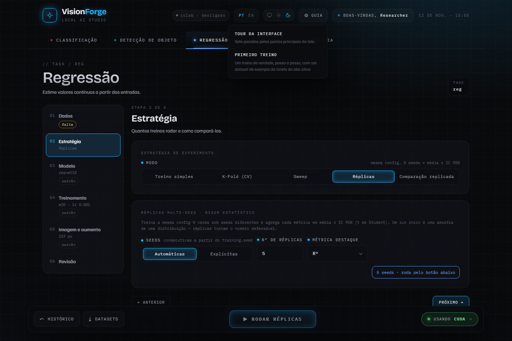

# Guias da interface

Cada página responde a uma pergunta e pode ser lida sozinha. Os prints vêm de
`python scripts/capture_docs_images.py`, que sobe a GUI deste checkout e os
refaz; nenhum é editado à mão ([`../images/README.md`](../images/README.md)).

## Começar

| Quero... | Página |
| --- | --- |
| instalar | [`../INSTALL.md`](../INSTALL.md) |
| treinar pela primeira vez, sem ter um dataset | [Primeiro treino](primeiro-treino.md) |
| baixar um dataset de um provedor | [`../DATASETS.md`](../DATASETS.md) |
| explorar, auditar, redividir, juntar ou converter um dataset | [Datasets na interface](datasets.md) |

## Treinar com rigor

| Quero... | Página |
| --- | --- |
| escolher entre treino simples, K-fold, busca, réplicas e comparação | [Estratégias](estrategias.md) |
| partir de pesos pré-treinados, congelar o backbone ou fazer fine-tuning | [Modelo e transfer learning](modelo-e-transfer-learning.md) |
| aplicar filtros, mudar a resolução ou o aumento de dados | [Imagem e aumento](imagem-e-aumento.md) |
| repetir um resultado e saber o que muda entre máquinas | [`../REPRODUCIBILITY.md`](../REPRODUCIBILITY.md) |
| entender como o nome de um experimento é montado | [Nomes de experimentos](nomes-de-experimentos.md) |
| ler o código que treinou o meu modelo | [Aba Código](codigo.md) |
| treinar no Google Colab | [Colab](colab.md) |

## Usar e publicar o resultado

| Quero... | Página |
| --- | --- |
| reabrir uma execução, exportar para ONNX, rodar em lote, ver Grad-CAM | [Depois do treino](depois-do-treino.md) |
| acompanhar treinos no MLflow, no Weights & Biases ou no Comet | [MLflow](mlflow.md), [W&B](wandb.md), [Comet](comet.md) |
| enviar um modelo ao Hugging Face Hub | [Hugging Face Hub](hugging-face-hub.md) |
| depositar uma execução no Zenodo | [Zenodo](zenodo.md) |
| enviar um relatório a um repositório do GitHub | [GitHub](github.md) |
| versionar uma execução com DVC | [DVC](dvc.md) |
| saber onde ficam tokens e chaves | [Tokens](tokens.md) |

## Estender

| Quero... | Página |
| --- | --- |
| criar uma tarefa ou um modelo meu | [`../custom/README.md`](../custom/README.md) |

## Ajuda dentro da interface

O botão **guia**, no cabeçalho, abre dois roteiros que rodam sobre a própria
tela. Na primeira visita a interface oferece os dois uma vez; depois disso
eles só abrem por esse botão.

- **Tour da interface**: sete paradas pelos pontos principais da tela.
- **Primeiro treino**: um treino de verdade, passo a passo, com um dataset de
  exemplo da tarefa da aba aberta.

Ao lado de cada campo, o **i** explica o que ele muda.
