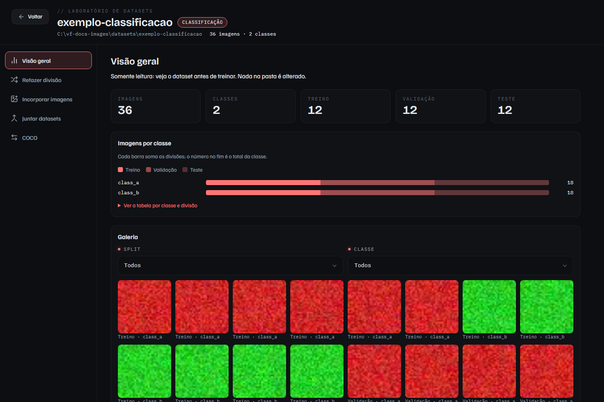

# Datasets na interface

O botão **datasets**, na barra de baixo, abre as ferramentas de dataset. Elas
têm duas abas: **Baixar** traz um dataset de um provedor
([`../DATASETS.md`](../DATASETS.md)) e **Explorar** abre uma pasta que já está
no computador.

Nenhuma ferramenta altera a pasta original. As que transformam um dataset
criam uma pasta nova ao lado dele.

## Explorar

Escolha o tipo (**Classificação**, com pastas por classe, ou **Detecção**, no
formato YOLO), aponte a pasta e clique em **Abrir**. A janela mostra um
resumo (imagens por divisão, número de classes, avisos) e o botão **Abrir
laboratório**.

O laboratório abre o dataset em tela cheia, com um menu à esquerda e uma
ferramenta por vez. **Visão geral** é somente leitura: totais, imagens por
classe em barras divididas por divisão, uma galeria e os tamanhos das
imagens. **Voltar** ou Esc devolve à janela.



Abaixo das barras, **As divisões têm a mesma mistura de classes?** compara a
proporção de cada classe entre treino, validação e teste, a partir das
contagens, sem abrir imagens:

- **Sim** quando nenhuma classe muda mais de 2 pontos percentuais entre as
  divisões; **Quase** até 5; **Não** acima disso ou quando uma classe falta
  numa divisão (o desempenho nela nunca é medido ali).
- A tabela mostra a proporção de cada classe por divisão e a diferença, das
  maiores para as menores.
- O V de Cramér resume tudo num número: 0 quando todas as divisões têm a mesma
  mistura, 1 quando a divisão determina a classe.
- A razão entre a maior e a menor classe de cada divisão mostra o
  desbalanceamento.

Se a resposta for **Não**, **Refazer divisão** redistribui estratificando por
classe.

A **Varredura de integridade** da Visão geral abre cada imagem e acha arquivos
que não abrem, cópias exatas e a mesma imagem em divisões diferentes. Ligue
**Procurar quase-duplicatas entre splits** para uma segunda passada que acha a
mesma foto reencodada, redimensionada ou com o brilho mudado; ela leva mais ou
menos o dobro do tempo, e cada grupo é para conferir, não um veredito.

Na detecção, a varredura também lê os rótulos e mostra o cartão **Caixas**:

- quantas caixas há por imagem, e quantas imagens não têm nenhuma (sem arquivo
  de rótulo ou com ele vazio). Para o treino, uma imagem sem caixa diz que ali
  não há objeto;
- o tamanho das caixas pelo critério do COCO, sobre a área em pixels: pequena
  abaixo de 32², média até 96², grande acima. São os grupos do mAP pequeno,
  médio e grande; com poucas caixas num grupo, a métrica dele oscila muito. A
  tabela por classe fica atrás de um botão;
- a proporção das caixas (largura / altura, em pixels);
- um mapa de calor 10 × 10 de onde caem os centros das caixas;
- as classes que aparecem juntas na mesma imagem;
- as linhas de rótulo que o treino não lê como caixa: não são cinco números,
  classe fora do `data.yaml`, largura ou altura zero, ou caixa que passa da
  borda da imagem (com 1% de folga). A lista mostra o arquivo e a linha.

Em pastas grandes a varredura pode ler uma amostra espaçada em vez de todas as
imagens; a tela diz quando foi o caso.

A última varredura que termina fica guardada (fora do dataset, em
`outputs/explorer_scans/`) e aparece ao reabrir o dataset, com a data. Se
depois disso alguma imagem foi adicionada, removida, renomeada, editada ou
mudou de classe, a tela avisa que o resultado pode estar desatualizado. Uma
varredura cancelada não é guardada.

As outras entradas do menu são as ferramentas abaixo. Na detecção, a janela
tem ainda o atalho **Converter uma pasta COCO**, que abre o laboratório direto
na importação, sem um dataset aberto.

| Ferramenta | Use quando | O que cria |
| --- | --- | --- |
| **Refazer divisão** | a proporção entre treino e validação não serve, ou imagens parentes caíram em divisões diferentes | um dataset novo com treino e validação redistribuídos |
| **Incorporar imagens** | chegaram imagens novas | um dataset novo com as antigas onde estavam e as novas distribuídas |
| **Juntar com outro dataset** | há dois datasets do mesmo tipo para treinar juntos | um dataset novo com os dois |
| **Exportar para COCO** | outra ferramenta espera COCO | uma pasta COCO |
| **Importar COCO** | as anotações estão em COCO e a detecção precisa de YOLO | um dataset YOLO |

## Refazer divisão

Junta treino e validação e redistribui pela proporção escolhida. **O teste
fica como está** por padrão, para os resultados continuarem comparáveis com os
de antes; dá para liberar o teste também, e a tela avisa que os resultados
deixam de ser comparáveis com os de execuções anteriores.

Se várias imagens vêm da mesma origem (mesmo paciente, mesma lâmina, mesmo
vídeo), informe um CSV de grupos:

```csv
path,group
train/gato/img001.jpg,animal_17
train/gato/img002.jpg,animal_17
val/gato/img003.jpg,animal_42
```

O `path` é relativo à pasta do dataset. Imagens do mesmo grupo vão sempre para
a mesma divisão; as que o arquivo não cita formam um grupo cada uma.

A prévia mostra as imagens por classe e por divisão, antes e depois. A seed
da divisão fica registrada no dataset novo: mesma seed, mesma divisão.

## Incorporar imagens

Aponte a pasta das imagens novas: uma subpasta por classe na classificação;
cada imagem com o seu `.txt` na detecção (com `classes.txt` ou `data.yaml` na
pasta, as classes são casadas pelo nome). As imagens que já existiam ficam
onde estavam, e as novas são distribuídas na proporção do dataset ou em outra
que você escolher.

## Juntar com outro dataset

O outro dataset precisa ser do mesmo tipo e ter a mesma organização de pastas.
Cada imagem continua na divisão em que estava. Nenhum dos dois muda.

## COCO

**Exportar para COCO** grava as imagens em `images/<divisão>` e um
`annotations/instances_<divisão>.json` por divisão. O explorador não lê COCO,
então o resultado não é aberto ali.

**Importar COCO** lê os `.json` de anotações e as imagens e cria um dataset
YOLO ao lado da pasta. A divisão de cada arquivo é detectada pelo nome; quando
o nome não diz, você escolhe uma ou ignora o arquivo. Só as caixas são
importadas: polígonos de segmentação são ignorados.

## Auditar antes de treinar

Na etapa **Dados** de cada tarefa, **Auditar imagens** procura problemas nas
divisões que vão ser usadas:

- duplicatas exatas (mesmo SHA-256);
- divisões ausentes ou vazias;
- imagens ilegíveis;
- com um CSV de grupos, grupos que aparecem em mais de uma divisão.

A busca por duplicatas compara arquivos byte a byte. Ligue **Procurar
quase-duplicatas entre splits** para achar também a mesma foto reencodada,
redimensionada ou com o brilho mudado; uma foto recortada, girada ou espelhada
continua passando.

O que cada tarefa audita:

| Tarefa | Imagens lidas |
|---|---|
| Classificação | as pastas de treino, validação e teste |
| Detecção | `images/<divisão>` ou `<divisão>/images`; os rótulos ficam de fora. Com um `data.yaml` a auditoria não aparece |
| Segmentação | só a pasta de imagens de cada divisão; as máscaras ficam de fora |
| Regressão | as imagens que cada CSV lista. A mesma imagem em dois CSVs é uma duplicata entre divisões; uma linha que aponta para um arquivo que não existe conta como ilegível |
| Anomalia | a pasta de treino e a de teste inteira, normais e defeitos |

Na detecção, na segmentação e na regressão o teste é opcional: se ele não
existe, a auditoria diz "ausente (opcional)" e não conta isso como problema.

O mesmo CSV de grupos serve ao K-fold: grupos inteiros ficam no mesmo fold
([Estratégias](estrategias.md#k-fold-cv)).
