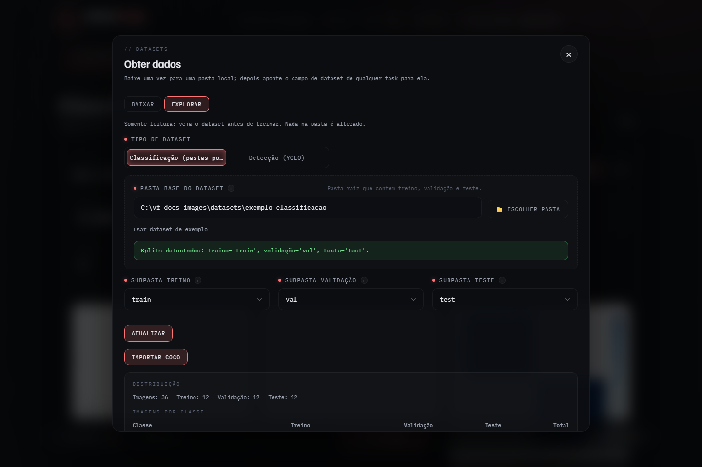

# Datasets na interface

O botão **datasets**, na barra de baixo, abre as ferramentas de dataset. Elas
têm duas abas: **Baixar** traz um dataset de um provedor
([`../DATASETS.md`](../DATASETS.md)) e **Explorar** abre uma pasta que já está
no computador.

Nenhuma ferramenta altera a pasta original. As que transformam um dataset
criam uma pasta nova ao lado dele.

## Explorar

Escolha o tipo (**Classificação**, com pastas por classe, ou **Detecção**, no
formato YOLO), aponte a pasta e clique em **Abrir**. O explorador é somente
leitura: mostra quantas imagens há em cada divisão e em cada classe, e os
tamanhos das imagens.



Em pastas grandes a varredura pode ler uma amostra espaçada em vez de todas as
imagens; a tela diz quando foi o caso.

Com um dataset aberto, as ferramentas abaixo ficam disponíveis.

| Ferramenta | Use quando | O que cria |
| --- | --- | --- |
| **Refazer divisão** | a proporção entre treino e validação não serve, ou imagens parentes caíram em divisões diferentes | um dataset novo com treino e validação redistribuídos |
| **Incorporar imagens** | chegaram imagens novas | um dataset novo com as antigas onde estavam e as novas distribuídas |
| **Juntar com outro dataset** | há dois datasets do mesmo tipo para treinar juntos | um dataset novo com os dois |
| **Exportar para COCO** | outra ferramenta espera COCO | uma pasta COCO |
| **Importar COCO** | as anotações estão em COCO e a detecção precisa de YOLO | um dataset YOLO |

## Refazer divisão

Junta treino e validação e redistribui pela proporção escolhida. **O teste
fica como está** por padrão, para os resultados continuarem comparáveis com os
de antes; dá para liberar o teste também, e a tela avisa que os resultados
deixam de ser comparáveis com os de execuções anteriores.

Se várias imagens vêm da mesma origem (mesmo paciente, mesma lâmina, mesmo
vídeo), informe um CSV de grupos:

```csv
path,group
train/gato/img001.jpg,animal_17
train/gato/img002.jpg,animal_17
val/gato/img003.jpg,animal_42
```

O `path` é relativo à pasta do dataset. Imagens do mesmo grupo vão sempre para
a mesma divisão; as que o arquivo não cita formam um grupo cada uma.

A prévia mostra as imagens por classe e por divisão, antes e depois. A seed
da divisão fica registrada no dataset novo: mesma seed, mesma divisão.

## Incorporar imagens

Aponte a pasta das imagens novas: uma subpasta por classe na classificação;
cada imagem com o seu `.txt` na detecção (com `classes.txt` ou `data.yaml` na
pasta, as classes são casadas pelo nome). As imagens que já existiam ficam
onde estavam, e as novas são distribuídas na proporção do dataset ou em outra
que você escolher.

## Juntar com outro dataset

O outro dataset precisa ser do mesmo tipo e ter a mesma organização de pastas.
Cada imagem continua na divisão em que estava. Nenhum dos dois muda.

## COCO

**Exportar para COCO** grava as imagens em `images/<divisão>` e um
`annotations/instances_<divisão>.json` por divisão. O explorador não lê COCO,
então o resultado não é aberto ali.

**Importar COCO** lê os `.json` de anotações e as imagens e cria um dataset
YOLO ao lado da pasta. A divisão de cada arquivo é detectada pelo nome; quando
o nome não diz, você escolhe uma ou ignora o arquivo. Só as caixas são
importadas: polígonos de segmentação são ignorados.

## Auditar antes de treinar

Na etapa **Dados** da classificação, **Auditar imagens** procura problemas nas
divisões que vão ser usadas:

- duplicatas exatas (mesmo SHA-256);
- divisões ausentes ou vazias;
- imagens ilegíveis;
- com um CSV de grupos, grupos que aparecem em mais de uma divisão.

A auditoria compara arquivos byte a byte. Ela não detecta imagens parecidas,
como a mesma foto recortada ou recomprimida.

O mesmo CSV de grupos serve ao K-fold: grupos inteiros ficam no mesmo fold
([Estratégias](estrategias.md#k-fold-cv)).
