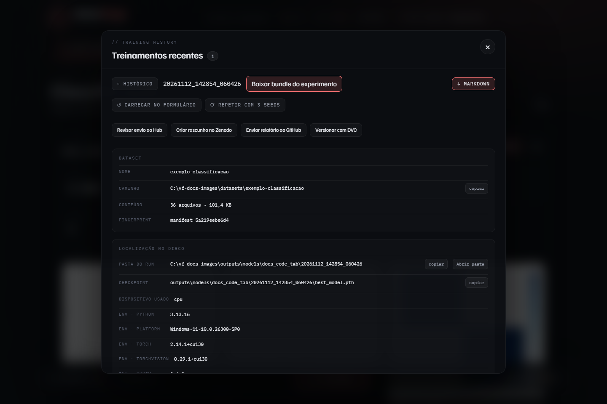

# Depois do treino

Tudo o que se faz com uma execução pronta parte do **Histórico**, na barra de
baixo. Clique numa execução para abrir o detalhe.

## Reabrir e repetir

| Botão | O que faz |
| --- | --- |
| **Carregar no formulário** | devolve a configuração da execução às etapas, para ajustar e treinar de novo |
| **Repetir com 3 seeds** | monta [réplicas](estrategias.md#réplicas) da mesma configuração |
| **Markdown** | baixa o relatório da execução |
| **Baixar bundle do experimento** | baixa um ZIP verificável com `run.json` e os artefatos ([`../REPRODUCIBILITY.md`](../REPRODUCIBILITY.md)) |

No Histórico, **Selecionar** marca execuções para comparar ou excluir, e
**Ranking** ordena as execuções de cada dataset por uma métrica.

## O que está registrado

O detalhe mostra, nesta ordem: o dataset (caminho, conteúdo e fingerprint), a
pasta da execução e o checkpoint, o ambiente (versões de Python, torch e das
demais bibliotecas, GPU, commit do git), a configuração de treino, o pipeline
de imagem aplicado e as métricas com os gráficos.

## Usar o modelo

**Exportar ONNX** converte o checkpoint, compara a saída numérica com a do
PyTorch e mede a latência de inferência. O arquivo fica ao lado do
checkpoint, como `best_model.onnx`.

**Inferência em lote** roda o checkpoint sobre uma pasta de imagens e grava
um CSV com uma linha por imagem: classe e probabilidades na classificação,
valores previstos na regressão, score e decisão na anomalia.

**Grad-CAM** gera mapas de calor sobre imagens de exemplo, mostrando as
regiões que mais pesaram na saída: a classe predita na classificação, o
primeiro alvo na regressão e a classe 0 na segmentação.

## Publicar

Os quatro botões abaixo das ações abrem um painel cada.

| Botão | Destino | Página |
| --- | --- | --- |
| **Revisar envio ao Hub** | Hugging Face Hub | [Hugging Face Hub](hugging-face-hub.md) |
| **Criar rascunho no Zenodo** | Zenodo | [Zenodo](zenodo.md) |
| **Enviar relatório ao GitHub** | GitHub | [GitHub](github.md) |
| **Versionar com DVC** | repositório git deste computador | [DVC](dvc.md) |

Cada página diz o que é enviado e o que fica de fora. Os tokens que esses
painéis pedem ficam salvos por perfil ([Tokens](tokens.md)).
