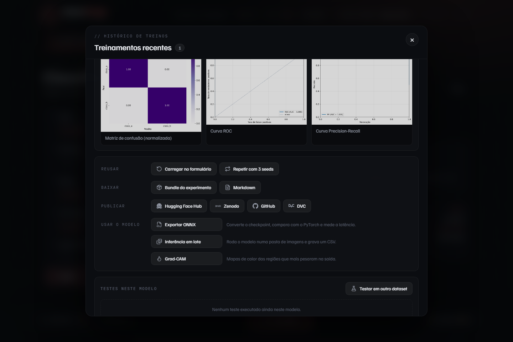

# Depois do treino

Tudo o que se faz com uma execução pronta parte do **Histórico**, na barra de
baixo. Clique numa execução para abrir o detalhe; **Ver resultados**, ao fim
de um treino, abre o mesmo detalhe.

## Reabrir e repetir

As ações ficam em grupos. **Reusar** e **Baixar**:

| Botão | O que faz |
| --- | --- |
| **Carregar no formulário** | devolve a configuração da execução às etapas, para ajustar e treinar de novo |
| **Repetir com 3 seeds** | monta [réplicas](estrategias.md#réplicas) da mesma configuração |
| **Bundle do experimento** | baixa um ZIP verificável com `run.json` e os artefatos ([`../REPRODUCIBILITY.md`](../REPRODUCIBILITY.md)) |
| **Markdown** | baixa o relatório da execução |

No Histórico, **Selecionar** marca execuções para comparar ou excluir, e
**Ranking** ordena as execuções de cada dataset por uma métrica.

## O que está registrado

O detalhe abre pelas métricas e pelas curvas por época, seguidas dos gráficos
gravados, das ações e dos testes do modelo. Abaixo ficam os blocos de
referência. Dataset (caminho, conteúdo e fingerprint) e configuração de treino
começam abertos; a pasta da execução e o checkpoint, o ambiente (versões de
Python, torch e das demais bibliotecas, GPU, commit do git) e o pipeline de
imagem abrem com um clique.

## Usar o modelo

**Exportar ONNX** converte o checkpoint, compara a saída numérica com a do
PyTorch e mede a latência de inferência. O arquivo fica ao lado do
checkpoint, como `best_model.onnx`.

**Inferência em lote** roda o checkpoint sobre uma pasta de imagens e grava
um CSV com uma linha por imagem: classe e probabilidades na classificação,
valores previstos na regressão, score e decisão na anomalia.

**Grad-CAM** gera mapas de calor sobre imagens de exemplo, mostrando as
regiões que mais pesaram na saída: a classe predita na classificação, o
primeiro alvo na regressão e a classe 0 na segmentação.

## Publicar

Os quatro botões do grupo **Publicar**, cada um com a marca do serviço, abrem
um painel cada.

| Botão | O que faz | Página |
| --- | --- | --- |
| **Hugging Face Hub** | revisa e envia checkpoint, model card e métricas | [Hugging Face Hub](hugging-face-hub.md) |
| **Zenodo** | cria um rascunho com o bundle | [Zenodo](zenodo.md) |
| **GitHub** | envia o relatório a um repositório | [GitHub](github.md) |
| **DVC** | versiona a execução num repositório git deste computador | [DVC](dvc.md) |

Cada página diz o que é enviado e o que fica de fora. Os tokens que esses
painéis pedem ficam salvos por perfil ([Tokens](tokens.md)).
