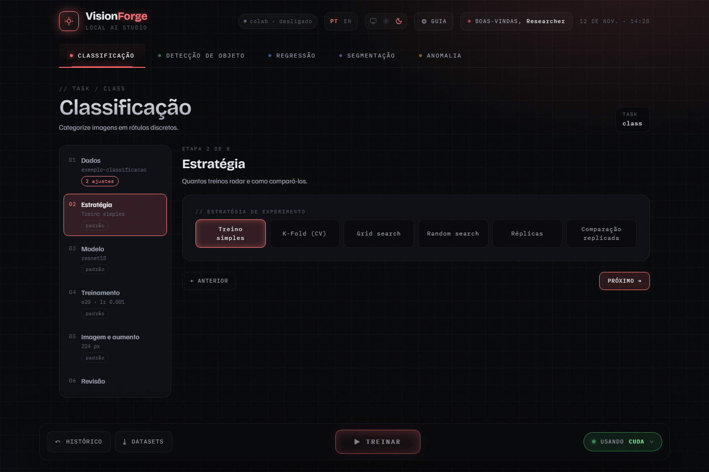
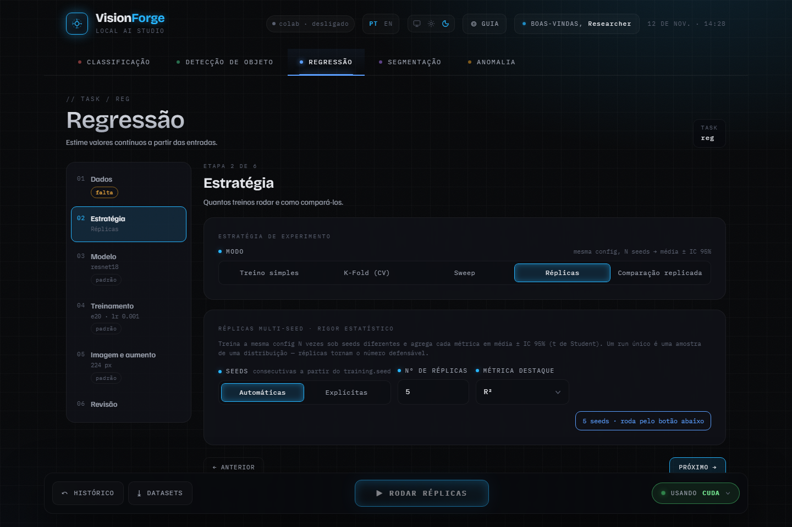

# Estratégias: quantos treinos rodar e como compará-los

A etapa **Estratégia** decide se o botão da barra roda um treino ou vários.
Todas partem da mesma configuração das outras etapas.



## Qual usar

| Pergunta | Estratégia | O que sai |
| --- | --- | --- |
| Isso treina? Qual é a ordem de grandeza da métrica? | Treino simples | um modelo e suas métricas |
| Tenho poucos dados e um split só de validação não é confiável | K-fold (CV) | média e desvio-padrão entre os folds |
| Qual combinação de hiperparâmetros é a melhor? | Grid search, Random search ou Sweep | ranking das combinações |
| Qual é o meu resultado, com incerteza? | Réplicas | média ± IC 95% entre seeds |
| A mudança X é melhor que a minha configuração? | Comparação replicada | teste pareado entre variantes |

As estratégias disponíveis mudam com a tarefa. A classificação tem **Grid
search** e **Random search**; a regressão tem **Sweep** no lugar deles.

## Treino simples

Um treino, uma seed. É o ponto de partida e o que o
[Primeiro treino](primeiro-treino.md) usa.

## K-fold (CV)

Divide os dados em K partes e treina K vezes, cada vez validando em uma parte
diferente. O relatório dá a média e o desvio-padrão amostral entre os folds,
sem intervalo de confiança.

Se várias imagens vêm da mesma origem (mesmo paciente, mesma lâmina, mesmo
vídeo), informe um **CSV de grupos** na etapa Dados, com as colunas
`path,group`. Grupos inteiros ficam no mesmo fold, e a validação não vê
imagens parentes das de treino.

## Grid search e Random search (classificação)

**Grid search** treina uma vez por combinação. Com ele ligado, os
hiperparâmetros das etapas Modelo e Treinamento ganham **+ valor ao grid**;
cada valor a mais multiplica o total, e 3 × 3 × 2 já são 18 treinos.

**Random search** sorteia `n_trials` configurações de um espaço que você
define. Cada parâmetro tem um tipo: `uniform`, `log_uniform` (indicado para
learning rate e weight decay) ou `choice` (lista de valores).

## Sweep

Varre hiperparâmetros pelo caminho na configuração, como
`training.learning_rate`, e ordena pela métrica na validação. Três modos:
grade (todas as combinações), aleatória (amostras) e Optuna (busca adaptativa).

## Réplicas

Treina a mesma configuração com N seeds e agrega cada métrica em média ± IC
95% (t de Student), com a tabela por seed. É a versão citável do resultado:
um treino só é uma amostra de uma distribuição.



As seeds podem ser **automáticas** (consecutivas a partir da seed da etapa
Treinamento) ou **explícitas**. Réplicas rodam só neste computador: o botão
do Colab fica desligado, com o motivo, enquanto a estratégia está escolhida.

Atalho: no detalhe de uma execução do Histórico, **Repetir com 3 seeds**
monta as réplicas daquela configuração.

## Comparação replicada

Responde se uma mudança é melhor que a sua configuração. O formulário é a
linha de base; você indica um campo (`training.learning_rate`, `model.name`,
...) e de 1 a 3 outros valores. Cada variante treina nas mesmas seeds (de 2 a
20), então o custo é variantes × seeds, mostrado antes de começar.

Cada par recebe um teste pareado (t ou Wilcoxon) com correção de Holm, e o
Histórico mostra a matriz. Use 6 seeds ou mais: com 5 ou menos, o Wilcoxon
não consegue devolver p abaixo de 0,05, e o cartão avisa.

## Pela linha de comando

As estratégias rodam sem a interface. Réplicas de uma configuração exportada:

```yaml
strategy:
  kind: replicates
  seeds: [0, 1, 2, 3, 4]
config:
  task: regression
  name: reg_resnet18
  # ... o resto da configuração exportada na etapa Revisão
```

```bash
visionforge run replicas.yaml
```

Os outros formatos (`replicated_comparison`, `sweep`, `cv`) e as tarefas que
cada um aceita estão em [`../QUICKSTART.md`](../QUICKSTART.md), seção 5.
