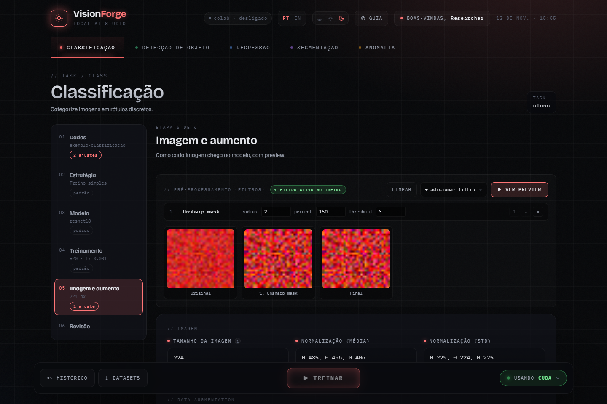

# Imagem e aumento

A etapa **Imagem e aumento** define como cada imagem chega ao modelo. São três
coisas, aplicadas nesta ordem:

| Ordem | O quê | Onde vale |
| --- | --- | --- |
| 1 | filtros de pré-processamento | treino, validação e teste |
| 2 | data augmentation | só treino |
| 3 | redimensionamento e normalização | treino, validação e teste |

## Filtros de pré-processamento

Um filtro muda a imagem antes de tudo o mais, em todas as divisões. Use quando
o problema pede: realçar bordas, tirar ruído, equalizar contraste. Sem um
motivo, deixe o pipeline vazio.

**+ adicionar filtro** escolhe um filtro; cada um vira uma linha com os seus
parâmetros. As setas mudam a ordem, que importa: os filtros rodam de cima para
baixo. **Ver preview** aplica o pipeline a uma imagem do dataset e mostra o
original, o resultado de cada filtro e o final.

| Filtro | O que faz |
| --- | --- |
| Gaussian blur | suaviza |
| Median blur | suaviza preservando bordas; bom contra ruído pontual |
| Unsharp mask | realça detalhe |
| Edges (Sobel) | deixa só as bordas |
| Emboss | relevo |
| Grayscale | tons de cinza |
| Equalize (CLAHE) | equaliza o histograma da imagem inteira (a equalização global do Pillow, uma aproximação simples de CLAHE) |
| Autocontrast | estica o contraste para a faixa inteira |
| Wavelet (Haar) | devolve uma sub-banda da decomposição Haar de um nível: LL (suavizada), LH, HL ou HH (detalhes) |

O preview precisa de um dataset escolhido na etapa Dados. Os filtros ativos
ficam registrados na configuração da execução e aparecem no detalhe dela no
Histórico.

## Imagem

**Tamanho da imagem** é a resolução de treino. Maior enxerga mais detalhe e
custa memória e tempo ao quadrado. Quando as imagens do dataset são menores
que o tamanho escolhido, a interface avisa: ampliar não acrescenta detalhe.

**Normalização** (média e desvio por canal R, G, B) vale para treino,
validação e teste. O padrão são os valores do ImageNet, os que os pesos
pré-treinados esperam. Só troque se for treinar do zero com estatísticas do
seu dataset.

## Data augmentation

Variações aleatórias aplicadas só às imagens de treino, para o modelo não
decorar. Validação e teste nunca recebem aumento.

| Campo | Padrão | Observação |
| --- | --- | --- |
| Augment | ligado | desligado, os valores abaixo ficam guardados mas não se aplicam |
| Flip horizontal | ligado | desligue quando esquerda e direita têm significado (texto, lateralidade em imagem médica) |
| Rotação (graus) | 10 | 0 desliga |
| Color jitter | desligado | varia brilho, contraste e saturação |

**Preview de augmentation** mostra o original ao lado de variantes sorteadas,
com os aumentos ativos listados. É a forma de conferir se uma rotação ou um
flip não está destruindo a informação que distingue as classes.
