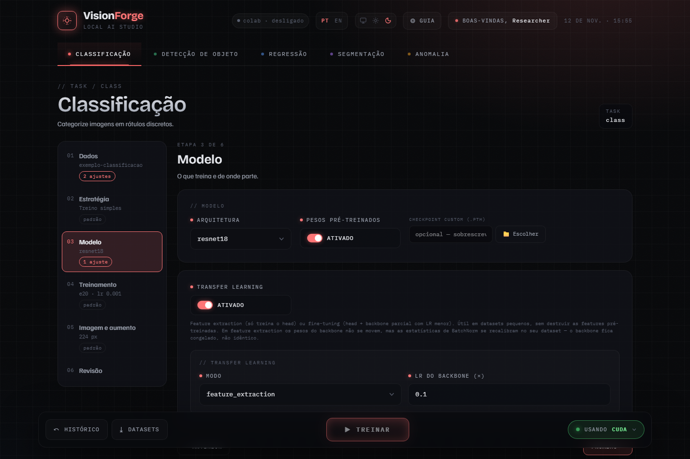

# Modelo e transfer learning

A etapa **Modelo** responde a duas perguntas: qual arquitetura treinar e de
onde ela parte.

## De onde o modelo parte

| Opção | Parte de | Quando |
| --- | --- | --- |
| **Pesos pré-treinados** ligado (padrão) | pesos do ImageNet | quase sempre: converge mais rápido e com menos dados |
| **Pesos pré-treinados** desligado | inicialização aleatória | dataset grande e muito diferente de fotos comuns, ou máquina sem internet |
| **Checkpoint custom (.pth)** | um arquivo seu | continuar de um modelo já treinado; sobrescreve os pesos do ImageNet |

Com pesos pré-treinados, o primeiro treino de cada arquitetura baixa os pesos.

Ao trocar de arquitetura, a interface pode sugerir um otimizador e um learning
rate para ela, com um botão para aplicar. É uma sugestão; o que foi medido e
em qual modelo aparece no próprio aviso.

## Transfer learning

Com pesos pré-treinados, o treino padrão ajusta a rede inteira com o mesmo
learning rate. **Transfer learning** muda isso: preserva o que o backbone já
sabe e concentra o treino na parte nova. Ajuda em datasets pequenos.



| Modo | O que treina | Use quando |
| --- | --- | --- |
| `feature_extraction` (padrão) | só o head; os pesos do backbone não se movem | poucos dados, ou um primeiro resultado rápido |
| `fine_tuning` | head e backbone, este com learning rate menor | há dados para adaptar o backbone sem destruí-lo |

Campos:

- **LR do backbone (×)**: o learning rate do backbone é o learning rate da
  etapa Treinamento multiplicado por este valor. Vai de acima de 0 até 1; o
  padrão é 0,1.
- **Descongelar a partir de** (só em `fine_tuning`): o nome de uma camada. As
  camadas antes dela ficam congeladas; dela em diante, tudo treina. Vazio,
  todas as camadas treinam.

### O que "congelado" não cobre

Em `feature_extraction` os pesos do backbone não mudam, mas as estatísticas de
BatchNorm se recalibram no seu dataset: elas são atualizadas na passagem das
imagens, não pelo otimizador. Ao relatar, escreva "pesos congelados,
normalização recalibrada", e não "backbone inalterado".

### Com as estratégias

Transfer learning é um treino simples. Enquanto K-fold, busca, réplicas ou
comparação replicada está escolhida na etapa [Estratégia](estrategias.md), o
interruptor fica travado, com o motivo ao lado; volte para **Treino simples**
para ligá-lo.

## Em YAML

```yaml
block: transfer_learning
model:
  name: resnet18
  pretrained: true
transfer_learning:
  mode: fine_tuning
  unfreeze_from_layer: layer3
  backbone_lr_multiplier: 0.1
# ... o resto da configuração exportada na etapa Revisão
```

`layer3` é um nome de camada do `resnet18`; cada arquitetura tem os seus. Um
nome que não existe no modelo interrompe o treino com erro.
