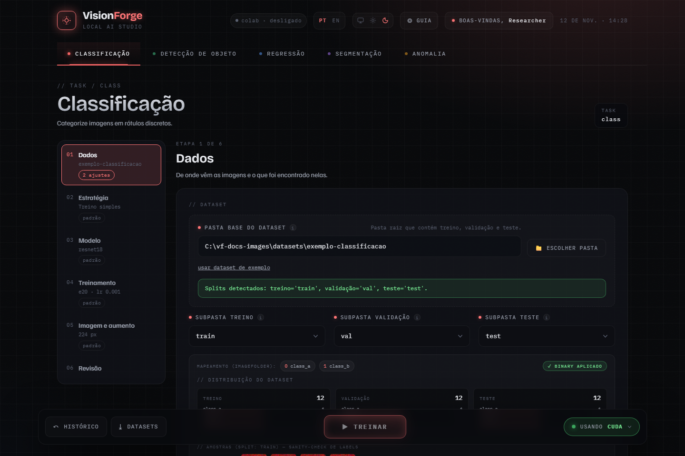
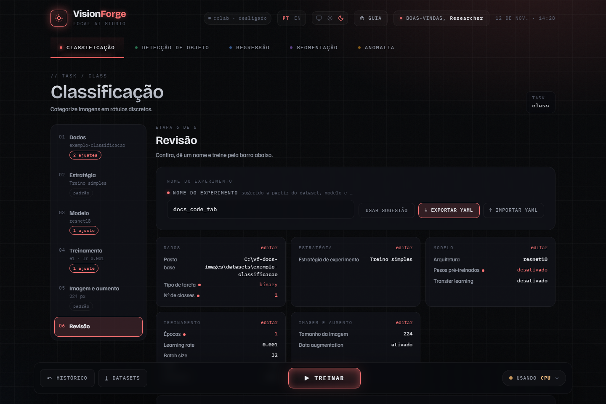
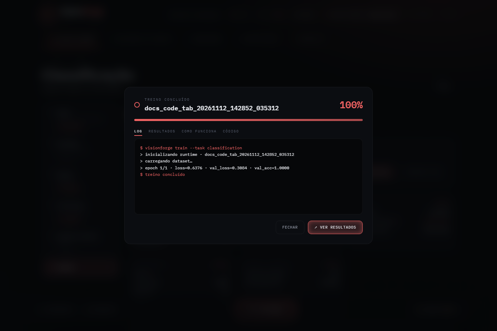
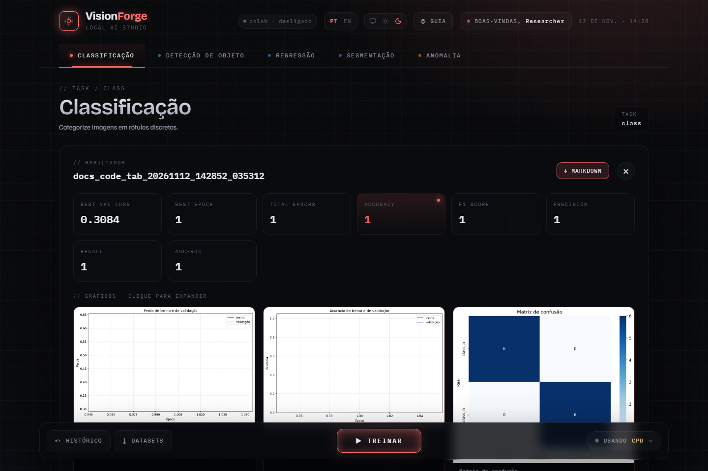

# Primeiro treino

Do zero a um modelo treinado e avaliado, sem ter um dataset. O dataset de
exemplo é pequeno o bastante para treinar em CPU. O mesmo caminho existe
guiado dentro da interface: **guia → Primeiro treino**.

Antes: [instale](../INSTALL.md) e rode `visionforge gui`.

## 1. Dados

Na aba **Classificação**, etapa **Dados**, clique em **usar dataset de
exemplo**. O VisionForge cria `datasets/exemplo-classificacao/` na pasta de
onde foi iniciado, com duas classes sintéticas, e preenche a pasta base e as
subpastas de treino, validação e teste.



Com um dataset seu, aponte a **pasta base**. A classificação espera uma pasta
por classe dentro de cada split:

```text
meu-dataset/
  train/
    gato/  img001.jpg ...
    cachorro/  ...
  val/
    gato/ ...
    cachorro/ ...
  test/
    ...
```

Os nomes usuais (`train`/`val`/`test`, `treino`/`validacao`/`teste`) são
encontrados sozinhos. Os outros formatos estão em
[`../DATASETS.md`](../DATASETS.md).

## 2. Estratégia, Modelo, Treinamento, Imagem e aumento

Para o primeiro treino, deixe tudo no padrão. As etapas à esquerda mostram o
que cada uma vai usar:

| Etapa | Padrão |
| --- | --- |
| Estratégia | Treino simples |
| Modelo | `resnet18` com pesos pré-treinados |
| Treinamento | 20 épocas, learning rate 0,001, batch 32, seed 42 |
| Imagem e aumento | 224 px, flip horizontal e rotação |

Com pesos pré-treinados ligados, o primeiro treino de cada arquitetura baixa
os pesos. Sem internet, desligue **Pesos pré-treinados** na etapa Modelo.

Quando o padrão não basta, veja [Estratégias](estrategias.md).

## 3. Revisão

O botão **Treinar** só libera depois que a etapa **Revisão** é aberta com um
dataset escolhido. Ela mostra tudo o que vai rodar, sugere um nome para o
experimento e tem os botões de exportar e importar a configuração em YAML.



O YAML exportado é a configuração exata que a interface envia. Ele roda de
novo pela linha de comando:

```bash
visionforge run meu_experimento.yaml
```

## 4. Treinar

**Treinar** abre o painel de treino. A aba **Log** mostra uma linha por época;
**Resultados** mostra as curvas enquanto o treino roda; **Como funciona**
explica o que está acontecendo; [**Código**](codigo.md) mostra as funções que
estão treinando o modelo. **Minimizar** devolve a tela; o treino continua.



## 5. Resultado

**Ver resultados** mostra as métricas e os gráficos: perda e acurácia por
época, matriz de confusão, curva ROC e curva Precision-Recall. **Markdown**
baixa o relatório da execução.



O print acima vem de um treino de uma época no dataset de exemplo: as curvas
têm um ponto só. Tudo fica em disco, em `outputs/models/<nome>/<data_hora>/`:

| Arquivo | O que é |
| --- | --- |
| `run.json` | configuração, seed, histórico por época, métricas e ambiente |
| `best_model.pth` | pesos da melhor época |
| `loss.png`, `accuracy.png`, `confusion_matrix.png`, ... | os gráficos da tela |

## E agora

- O número de um treino só é uma amostra. Para um resultado com intervalo de
  confiança, rode [réplicas](estrategias.md#réplicas).
- Para usar o modelo: [Depois do treino](depois-do-treino.md).
