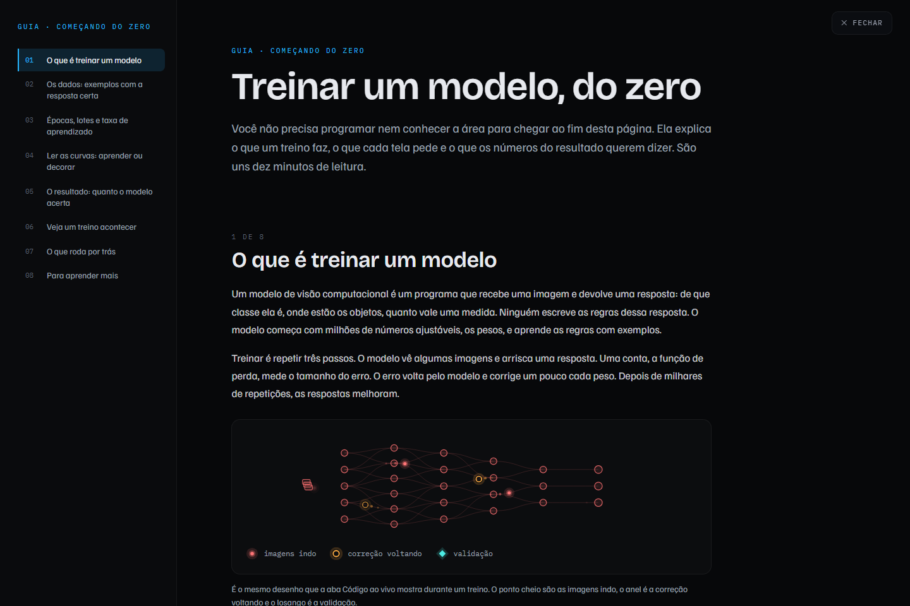
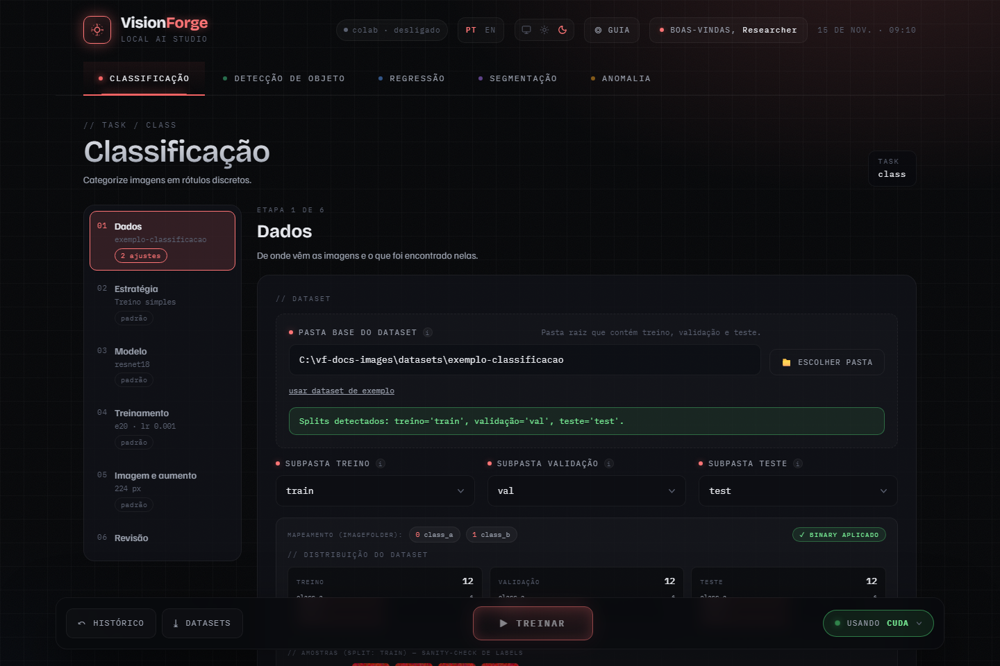
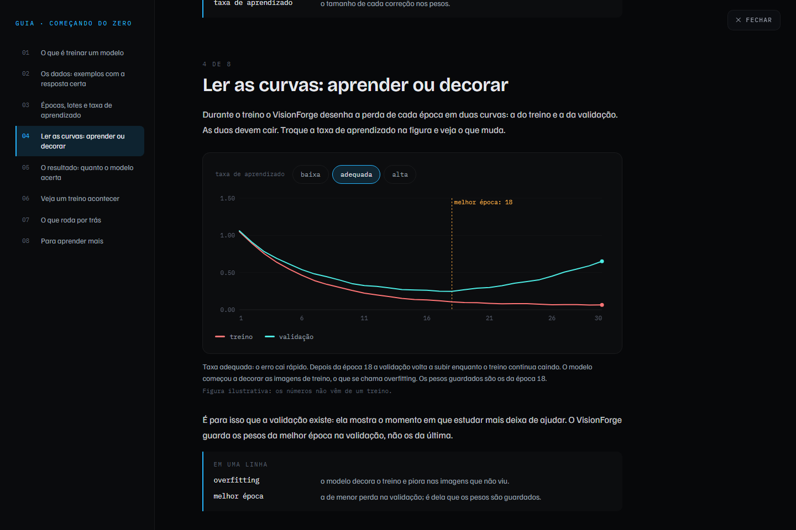
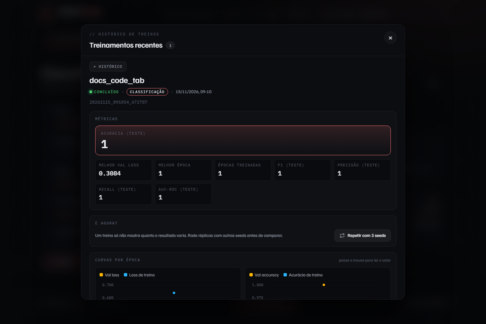
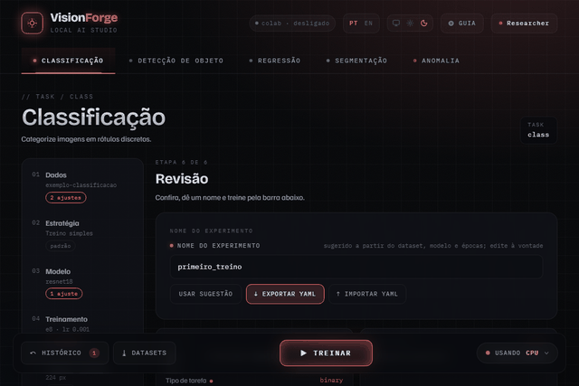

# Começando do zero

Para quem nunca treinou um modelo. Você não precisa programar nem conhecer a
área para chegar ao fim desta página: ela explica o que um treino faz, o que
cada tela pede e o que os números do resultado querem dizer.

O mesmo conteúdo está dentro da interface, com figuras animadas: botão
**guia**, no cabeçalho, opção **Começando do zero**.

Se você já treina modelos e só quer aprender o VisionForge, vá para
[Já treino modelos](ja-treino-modelos.md).

## 1. O que é treinar um modelo

Um modelo de visão computacional é um programa que recebe uma imagem e devolve
uma resposta: de que classe ela é, onde estão os objetos, quanto vale uma
medida. Ninguém escreve as regras dessa resposta. O modelo começa com milhões
de números ajustáveis, os pesos, e aprende as regras com exemplos.

Treinar é repetir três passos:

1. o modelo vê algumas imagens e arrisca uma resposta;
2. uma conta, a função de perda, mede o tamanho do erro;
3. o erro volta pelo modelo e corrige um pouco cada peso.

Depois de milhares de repetições, as respostas melhoram.

| Termo | Em uma linha |
| --- | --- |
| peso | um dos números que o treino ajusta; um modelo tem milhões |
| perda (loss) | o tamanho do erro numa leva de imagens; o treino tenta diminuí-la |
| gradiente | a direção em que cada peso deve mudar para o erro cair |

## 2. Os dados: exemplos com a resposta certa

Para classificar, o dataset é uma pasta com uma subpasta por classe: as imagens
de cada classe ficam na subpasta que leva o nome dela. É assim que o
VisionForge sabe a resposta certa de cada imagem.

As imagens são divididas em três partes que nunca se misturam:

| Parte | Para que serve | Uma divisão comum |
| --- | --- | --- |
| treino | é o que o modelo estuda | 70% |
| validação | uma prova ao fim de cada época, para ver se ele está aprendendo | 15% |
| teste | a prova final, com imagens que ele nunca viu, usada uma vez só | 15% |

Na etapa **Dados** você aponta a pasta, e o VisionForge mostra as divisões e as
classes que encontrou. Se ainda não tem imagens, o botão **usar dataset de
exemplo** cria um conjunto pequeno para o primeiro treino.

| Termo | Em uma linha |
| --- | --- |
| dataset | o conjunto de imagens, com a resposta certa de cada uma |
| classe | uma das respostas possíveis, como "gato" ou "defeito" |
| divisão (split) | cada uma das partes: treino, validação e teste |

## 3. Épocas, lotes e taxa de aprendizado

O modelo não vê todas as imagens de uma vez. Ele recebe um lote (batch) por
vez, por exemplo 32 imagens, corrige os pesos e passa ao lote seguinte. Quando
todos os lotes do treino passaram, terminou uma época. Um treino tem várias
épocas: o modelo revê as mesmas imagens e erra menos a cada volta.

A taxa de aprendizado (learning rate) é o tamanho de cada correção, e é o
número que mais muda o resultado. Pequena demais, o treino anda devagar. Grande
demais, as correções passam do ponto e o erro não assenta.

Na etapa **Treinamento** esses campos aparecem primeiro: épocas, tamanho do
batch e taxa de aprendizado. Os outros já vêm com valores que funcionam e ficam
recolhidos em **avançado**.

| Termo | Em uma linha |
| --- | --- |
| lote (batch) | as imagens que o modelo vê antes de cada correção |
| época | uma passada completa pelas imagens de treino |
| taxa de aprendizado | o tamanho de cada correção nos pesos |

## 4. Ler as curvas: aprender ou decorar

Durante o treino o VisionForge desenha a perda de cada época em duas curvas: a
do treino e a da validação. As duas devem cair.

A figura acima é ilustrativa: os números não vêm de um treino. Na interface
você troca a taxa de aprendizado e vê os três casos:

| Taxa | O que as curvas fazem |
| --- | --- |
| baixa | as duas caem, mas devagar; as épocas acabam antes de o modelo aprender |
| adequada | o erro cai rápido; a certa altura a validação volta a subir enquanto o treino continua caindo |
| alta | o erro pula de um lado para o outro e não assenta |

Quando a validação sobe e o treino continua caindo, o modelo começou a decorar
as imagens de treino. Isso se chama overfitting. É para isso que a validação
existe: ela mostra o momento em que estudar mais deixa de ajudar. O VisionForge
guarda os pesos da melhor época na validação, não os da última.

| Termo | Em uma linha |
| --- | --- |
| overfitting | o modelo decora o treino e piora nas imagens que não viu |
| melhor época | a de menor perda na validação; é dela que os pesos são guardados |

## 5. O resultado: quanto o modelo acerta

Terminado o treino, o modelo é medido no teste. A acurácia é a fração de
imagens que ele acertou. A matriz de confusão abre esse número: cada linha é a
classe verdadeira e cada coluna é a classe que o modelo respondeu.

Um exemplo inventado, com 60 imagens de teste de três classes:

| Verdadeira ↓ / prevista → | A | B | C |
| --- | --- | --- | --- |
| **A** | **18** | 1 | 1 |
| **B** | 2 | **16** | 2 |
| **C** | 0 | 3 | **17** |

A diagonal são os acertos: 18 + 16 + 17 = 51 em 60, acurácia de 85%. Fora
dela, cada célula diz qual classe foi confundida com qual: a classe B foi
confundida com C duas vezes e com A outras duas.

Um número sozinho pode ser sorte. O treino parte de pesos sorteados, e a seed
fixa esse sorteio. Mudar a seed muda um pouco o resultado. Para saber quanto, a
estratégia **Réplicas** repete o treino com várias seeds e dá a média com um
intervalo de confiança ([Estratégias](../gui/estrategias.md)).

Cada tarefa tem a sua métrica: acurácia na classificação, mAP na detecção, mIoU
na segmentação, R² na regressão e AUROC na anomalia. A ideia é sempre a mesma:
medir em imagens que o modelo não viu.

| Termo | Em uma linha |
| --- | --- |
| acurácia | a fração de imagens em que o modelo acertou |
| seed | o número que fixa os sorteios do treino, para ele poder ser repetido |
| métrica | a conta que resume o resultado; cada tarefa tem a sua |

## 6. Veja um treino acontecer

A gravação mostra um treino real de oito épocas no dataset de exemplo, na CPU,
da etapa Revisão ao resultado. A barra avança a cada época, o log mostra a
perda caindo, e no fim o resultado abre no Histórico. A gravação pula os
intervalos entre os quadros.

O próximo passo é fazer o seu. Na interface, o guia **Primeiro treino**
acompanha cada clique na própria tela, com o dataset de exemplo. A versão em
texto está em [Primeiro treino](../gui/primeiro-treino.md).

## 7. O que roda por trás

O VisionForge não tem um treino próprio escondido: ele organiza bibliotecas
abertas que a área inteira usa, e a aba **Código ao vivo** mostra o código que
está rodando ([Aba Código](../gui/codigo.md)). Vale conhecer cada uma pelo
nome.

| Biblioteca | O que faz aqui |
| --- | --- |
| [PyTorch](https://pytorch.org/) | a biblioteca de redes neurais em que todo modelo é treinado |
| [torchvision](https://docs.pytorch.org/vision/stable/) | arquiteturas prontas, pesos pré-treinados e transformações de imagem |
| [timm](https://huggingface.co/docs/timm) | centenas de arquiteturas a mais, escolhidas pelo nome |
| [Ultralytics](https://docs.ultralytics.com/) | YOLO e RT-DETR para detecção de objetos; vem instalado com o VisionForge (AGPL-3.0) |
| [scikit-learn](https://scikit-learn.org/stable/) | as métricas do resultado e a divisão do K-fold |
| [Optuna](https://optuna.org/) | a busca guiada de hiperparâmetros |
| [ONNX Runtime](https://onnxruntime.ai/) | roda o modelo exportado em ONNX, fora do PyTorch |
| [FastAPI](https://fastapi.tiangolo.com/) | o servidor local com que a interface conversa |
| [React](https://react.dev/) | a interface |
| [Pydantic](https://docs.pydantic.dev/) | confere a configuração antes de o treino começar |

## 8. Para aprender mais

Esta página dá o vocabulário. Para entender a área de verdade, estes materiais
são gratuitos e muito usados em cursos.

| Material | O que é | Idioma |
| --- | --- | --- |
| [Dive into Deep Learning](https://pt.d2l.ai/) | livro aberto com teoria e código lado a lado | português |
| [Machine Learning Crash Course](https://developers.google.com/machine-learning/crash-course?hl=pt-br) | curso introdutório do Google, com exercícios | português |
| [3Blue1Brown: Neural networks](https://www.3blue1brown.com/topics/neural-networks) | vídeos com animações de como uma rede neural aprende | inglês |
| [Practical Deep Learning](https://course.fast.ai/) | curso prático: você treina um modelo já na primeira aula | inglês |
| [CS231n](https://cs231n.stanford.edu/) | o curso de Stanford sobre redes neurais para visão computacional | inglês |
| [PyTorch Tutorials](https://docs.pytorch.org/tutorials/) | os tutoriais oficiais do PyTorch | inglês |
| [Deep Learning](https://www.deeplearningbook.org/) | o livro-texto da área, de Goodfellow, Bengio e Courville, com a matemática por trás | inglês |

Na documentação do VisionForge:

- [Primeiro treino](../gui/primeiro-treino.md), passo a passo;
- [Estratégias](../gui/estrategias.md): quando usar K-fold, busca, réplicas e
  comparação;
- [Depois do treino](../gui/depois-do-treino.md): o que fazer com o resultado;
- [Datasets na interface](../gui/datasets.md): explorar, auditar e redividir;
- [O que o VisionForge faz](o-que-o-visionforge-faz.md): todas as
  funcionalidades, com a tela de cada uma;
- [Guias da interface](../gui/README.md): o índice de todas as páginas.
