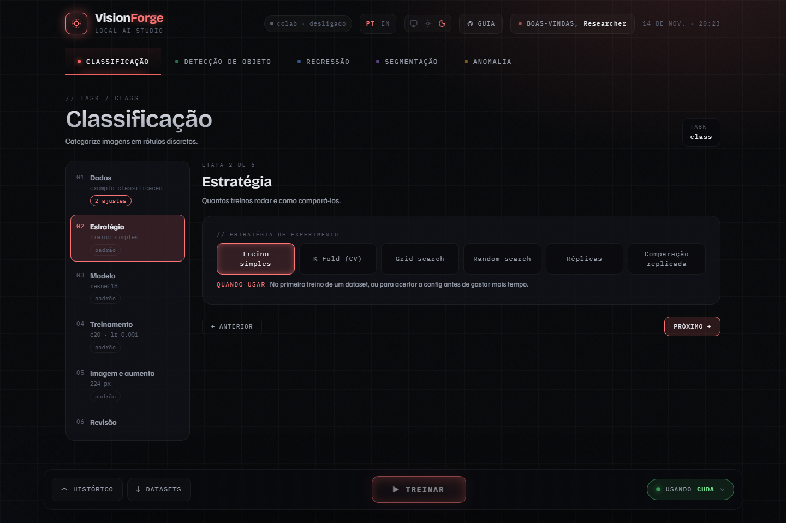
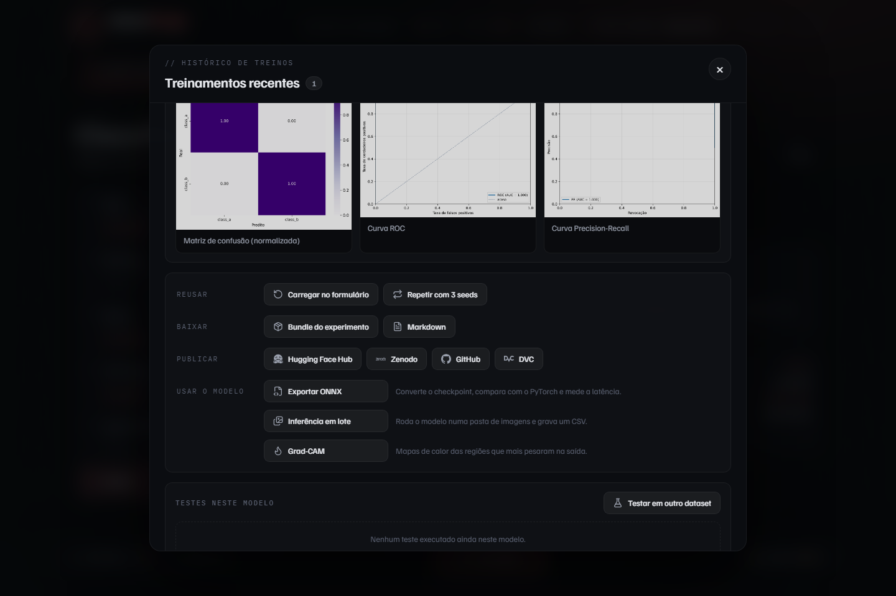

# Já treino modelos: o VisionForge em dez minutos

Para quem já escreve o próprio loop em PyTorch: o VisionForge é uma interface
local para cinco tarefas de visão (classificação, regressão, segmentação,
detecção e anomalia) que monta a configuração, treina e registra cada execução
em disco. Ele roda na sua máquina; nada sai dela sem você pedir. Esta página
diz onde fica o que você já faz e o que o projeto faz por você.

Se os termos desta página são novos para você, comece por
[Começando do zero](comecando-do-zero.md). Para ver todas as funcionalidades
com a tela de cada uma, [O que o VisionForge faz](o-que-o-visionforge-faz.md).

## Instalar e abrir

```bash
pip install visionforge-studio
visionforge doctor --fix      # Windows e Linux com NVIDIA: troca o torch pelo da sua GPU
visionforge gui               # abre http://127.0.0.1:8000
```

O passo a passo por sistema, com ambiente virtual e Mac, está em
[`../INSTALL.md`](../INSTALL.md). Para conferir a instalação sem dataset nem
GPU, `visionforge selftest --quick` treina cada tarefa com dados sintéticos.

## Onde fica o que você já faz

Cada aba de tarefa configura um treino em seis etapas: **Dados**,
**Estratégia**, **Modelo**, **Treinamento**, **Imagem e aumento** e
**Revisão**. O botão de treinar (**▶ Treinar** no treino simples, **▶ Rodar
réplicas** com réplicas, e assim por diante) fica na barra de baixo, junto de
**histórico** e **datasets**.

| O que você já faz | Onde fica | Página |
| --- | --- | --- |
| montar dataset e splits | etapa **Dados**; botão **datasets** na barra de baixo para baixar, explorar, redividir, juntar e converter | [Datasets na interface](../gui/datasets.md) |
| escolher arquitetura e pesos pré-treinados | etapa **Modelo**: arquitetura, **Pesos pré-treinados**, **Checkpoint custom (.pth)** | [Modelo e transfer learning](../gui/modelo-e-transfer-learning.md) |
| congelar o backbone ou fazer fine-tuning | etapa **Modelo**, **Transfer learning** (`feature_extraction` ou `fine_tuning`) | [Modelo e transfer learning](../gui/modelo-e-transfer-learning.md) |
| hiperparâmetros (épocas, learning rate, batch, otimizador, seed) | etapa **Treinamento** | [Primeiro treino](../gui/primeiro-treino.md) |
| augmentation, resolução, normalização, filtros | etapa **Imagem e aumento** | [Imagem e aumento](../gui/imagem-e-aumento.md) |
| K-fold | etapa **Estratégia**, **K-Fold (CV)**; CSV de grupos na etapa Dados | [Estratégias](../gui/estrategias.md) |
| grid, random search, sweep | etapa **Estratégia**: **Grid search** e **Random search** na classificação, **Sweep** nas outras | [Estratégias](../gui/estrategias.md) |
| réplicas com várias seeds | etapa **Estratégia**, **Réplicas** | [Estratégias](../gui/estrategias.md) |
| comparar variantes com teste pareado | etapa **Estratégia**, **Comparação replicada** | [Estratégias](../gui/estrategias.md) |
| acompanhar o treino | painel de treino: abas **Log**, **Resultados** e **Código ao vivo** | [Aba Código](../gui/codigo.md) |
| métricas e curvas | **Ver resultados** ao fim do treino, ou uma execução no **histórico** | [Depois do treino](../gui/depois-do-treino.md) |
| exportar para ONNX | detalhe da execução no histórico, **Exportar ONNX** | [Depois do treino](../gui/depois-do-treino.md) |
| inferência em lote | detalhe da execução, **Inferência em lote** (grava um CSV) | [Depois do treino](../gui/depois-do-treino.md) |
| Grad-CAM | detalhe da execução, **Grad-CAM** | [Depois do treino](../gui/depois-do-treino.md) |
| MLflow, W&B, Comet | **Perfis**: liga o envio por perfil | [MLflow](../gui/mlflow.md), [W&B](../gui/wandb.md), [Comet](../gui/comet.md) |
| publicar (Hub, Zenodo, GitHub, DVC) | detalhe da execução, grupo **Publicar** | [Hub](../gui/hugging-face-hub.md), [Zenodo](../gui/zenodo.md), [GitHub](../gui/github.md), [DVC](../gui/dvc.md) |
| treinar no Colab | botão do Colab, só para classificação | [Colab](../gui/colab.md) |
| linha de comando | `visionforge run` com o YAML exportado na etapa Revisão | [Linha de comando](#linha-de-comando), abaixo |

As estratégias disponíveis mudam com a tarefa; a página
[Estratégias](../gui/estrategias.md) diz quais existem em cada uma.



## O que é diferente aqui

O que normalmente se faz à mão, ou se esquece, o VisionForge faz em todo treino:

- **Registro da execução.** Cada treino grava `run.json` com a configuração,
  a seed, o histórico por época, as métricas, o ambiente (versões de Python,
  torch, torchvision e das demais bibliotecas, CUDA, cuDNN, GPU e, num
  checkout git do pacote, o commit e se havia alterações locais) e um
  fingerprint do dataset.
- **Seed e determinismo por padrão.** `training.seed` vale 42 e
  `training.deterministic` vem ligado: semeia Python, NumPy e PyTorch e liga os
  kernels determinísticos. O que ainda varia entre GPUs e versões está em
  [`../REPRODUCIBILITY.md`](../REPRODUCIBILITY.md).
- **Incerteza no resultado.** Na classificação, regressão, segmentação e
  anomalia, as métricas de teste vêm com um intervalo bootstrap de 95% sobre o
  split de teste. **Réplicas** dá média ± IC 95% entre seeds; **Comparação
  replicada** treina cada variante nas mesmas seeds e aplica teste pareado
  (t ou Wilcoxon) com correção de Holm.
- **Relatório pronto para o artigo.** As estratégias com vários treinos gravam
  um resumo em JSON, um ranking em CSV e uma tabela LaTeX. Na classificação,
  regressão, segmentação e anomalia, as figuras saem em PNG, PDF ou SVG
  (`output.figure_formats`).
- **Configuração exportável.** **↓ Exportar YAML**, na etapa Revisão, grava a
  configuração exata que a interface envia; `visionforge run` a executa de novo
  e **↑ Importar YAML** a devolve ao formulário.
- **Retomada e evidência.** A retomada de um treino restaura modelo,
  optimizer, scheduler e estados aleatórios, e é recusada se o fingerprint
  mostrar que o dataset mudou. `visionforge bundle` empacota a execução com SHA-256 de
  cada arquivo.
- **O código que rodou.** A aba **Código ao vivo** mostra as funções do pacote
  instalado em cada passo do treino, lidas na hora, não uma cópia.

## As cinco tarefas

| Tarefa | Dataset esperado | Métrica principal |
| --- | --- | --- |
| Classificação | uma pasta por classe dentro de `train/`, `val/` e `test/` | `accuracy` |
| Regressão | `train.csv`, `val.csv` e `test.csv` com as colunas `image,target` (um ou mais alvos) e as imagens em `images/` | `r2` |
| Segmentação | `train/`, `val/` e `test/`, cada um com `images/` e `masks/`; a máscara tem um canal, valor do pixel = id da classe, e pareia pelo nome do arquivo | `miou` |
| Detecção | layout YOLO (`images/<split>` e `labels/<split>`, ou `<split>/images` e `<split>/labels`) ou um `data.yaml`; COCO se converte no laboratório de datasets | `map50_95` |
| Anomalia | estilo MVTec AD: `train/good/` só com imagens normais; `test/good/` e uma subpasta por defeito | `auroc` |

A anomalia não tem split de validação: o treino pontua cada época no split de
teste, e é por isso que o resultado mostra "AUROC (melhor época)" ao lado de
"AUROC (teste)", sem nenhum "(val)".

A métrica principal ordena o ranking das estratégias quando você não escolhe
outra. Os nomes de colunas e de pastas acima são os padrões da configuração
(`image_column`, `target_columns`, `normal_dir`, ...). A detecção tem dois backends, Ultralytics e torchvision; a
anomalia, dois métodos, autoencoder e PatchCore. Layouts e provedores de
download: [`../DATASETS.md`](../DATASETS.md).

## Linha de comando

| Comando | Para quê |
| --- | --- |
| `visionforge gui` | abre a interface (`--host`, `--port`, `--no-browser`) |
| `visionforge run config.yaml` | roda um YAML exportado; com `strategy:` + `config:`, roda réplicas, comparação, sweep ou K-fold |
| `visionforge doctor` | confere o ambiente e indica o torch certo; `--fix` instala depois de confirmar |
| `visionforge selftest` | treina cada tarefa com dados gerados; `--quick` só o treino simples |
| `visionforge audit-data PASTA` | procura duplicatas exatas entre splits, imagens ilegíveis e, com `--groups`, grupos que cruzam splits |
| `visionforge bundle RUN destino.zip` | exporta a execução com manifesto de hashes |
| `visionforge verify-bundle destino.zip` | confere o manifesto sem extrair o ZIP |
| `visionforge new-task CHAVE` | cria `user_tasks/CHAVE.py`, uma tarefa sua que já treina |

`run` e `gui` aceitam `--offline`, que recusa toda conexão para fora do
computador. `visionforge run --help` lista as opções de cada estratégia, e o
formato de cada uma está em [`../QUICKSTART.md`](../QUICKSTART.md), seção 5.

## Onde ficam os arquivos

Os caminhos são relativos à pasta de onde você rodou `visionforge gui`.

| Caminho | O que tem |
| --- | --- |
| `outputs/models/<nome>/<data_hora>/` | uma execução: `run.json`, `best_model.pth`, gráficos; `best_model.onnx` depois de exportar |
| `outputs/reports/` | relatórios das estratégias (`*_summary.json`, `*_ranking.csv`, `*_table.tex`) |
| `outputs/profiles/<perfil>/` | a pasta de saída de um perfil |
| `~/.visionforge/` | tokens e chaves ([Tokens](../gui/tokens.md)) |



## Estender

Uma arquitetura sua para classificação, regressão ou segmentação vai em
`user_models/`; uma tarefa inteira, com dados, loss e métricas seus, vai em
`user_tasks/`. As duas pastas ficam ao lado de onde você roda o VisionForge,
sem tocar no pacote. `visionforge doctor` mostra o que ele encontrou
em cada uma. Detalhes em [`../custom/README.md`](../custom/README.md).

## Para onde ir agora

- [Primeiro treino](../gui/primeiro-treino.md): o caminho completo na
  interface, com o dataset de exemplo.
- [Estratégias](../gui/estrategias.md): K-fold, buscas, réplicas e comparação.
- [`../REPRODUCIBILITY.md`](../REPRODUCIBILITY.md): auditoria de dados,
  determinismo, retomada e bundle.
- [`../QUICKSTART.md`](../QUICKSTART.md): o mesmo percurso em inglês, com os
  YAML de cada estratégia.
- [Guias da interface](../gui/README.md): o índice de todas as páginas.
