# O que o VisionForge faz

Esta página mostra, tela por tela, o que o VisionForge faz. Ela não ensina a
usar: cada seção diz o que a funcionalidade é, para que serve e onde fica, e
leva ao **Como usar** detalhado. Para treinar já, comece por
[Primeiro treino](../gui/primeiro-treino.md).

O VisionForge roda no seu computador, numa interface local (`visionforge gui`).
Nada sai dele sem você pedir: downloads de datasets, Colab e publicações são
opcionais, e as publicações têm prévia local.

Um treino do começo ao fim, gravado na interface: oito épocas no dataset de
exemplo, na CPU, da etapa Revisão ao resultado.

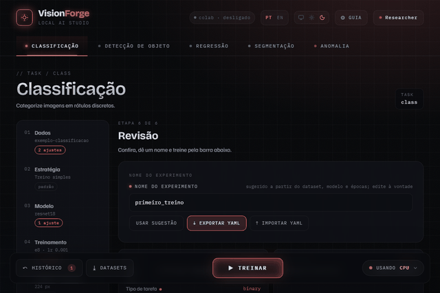

Novo na área? Comece por [Começando do zero](comecando-do-zero.md). Já treina
modelos? Vá para [Já treino modelos](ja-treino-modelos.md).

## As tarefas

Cinco tarefas de visão computacional, cada uma numa aba, todas configuradas nas
mesmas seis etapas: Dados, Estratégia, Modelo, Treinamento, Imagem e aumento e
Revisão.

| Tarefa | Modelos | Métricas principais |
| --- | --- | --- |
| Classificação | ResNet, EfficientNet, ViT, Swin, ConvNeXt, VGG, AlexNet, timm | acurácia, F1, AUC-ROC, matriz de confusão |
| Detecção de objetos | YOLOv8 a v26, RT-DETR, Faster R-CNN, SSD, RetinaNet | mAP@50, mAP@50-95 |
| Regressão de imagem | backbones CNN com cabeça linear (manifestos CSV) | MSE, RMSE, MAE, R² |
| Segmentação semântica | DeepLabV3, FCN, LR-ASPP, U-Net | mIoU, Dice, acurácia de pixel |
| Detecção de anomalia | autoencoder convolucional, PatchCore | AUROC de imagem, F1, limiar |

Os backends YOLO e RT-DETR usam o Ultralytics (AGPL-3.0), que só é instalado
com o extra `detection`; o backend torchvision já vem na instalação.

Se o seu problema não é nenhum dos cinco, veja [Estender](#estender).

## Preparar os dados

### Dataset de exemplo

Na etapa **Dados** de cada tarefa, **usar dataset de exemplo** cria um
dataset sintético pequeno, que treina em CPU. É o caminho para testar sem ter
dados.

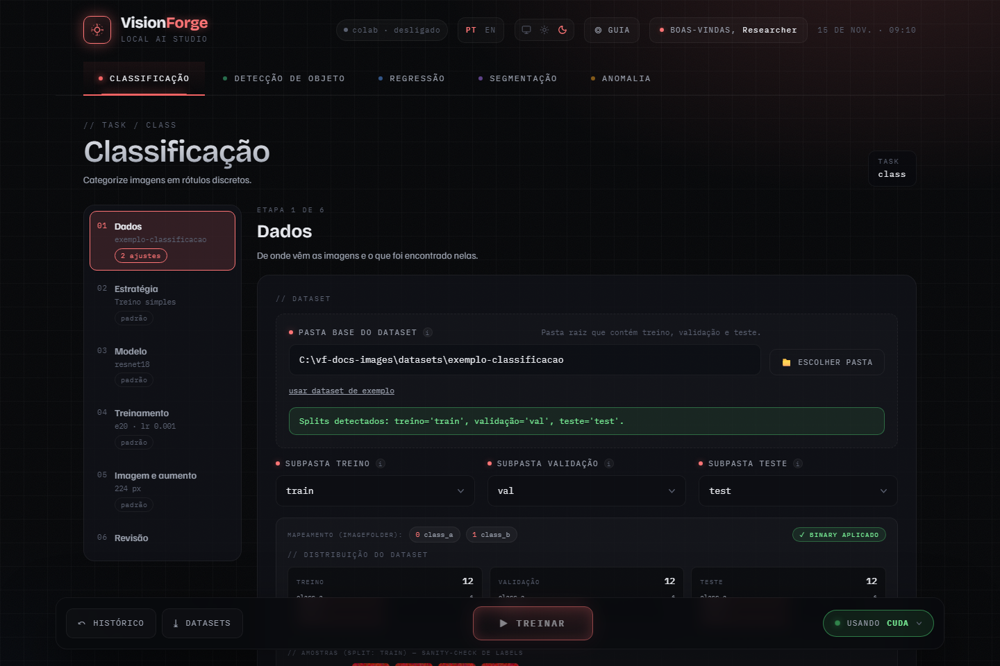

Como usar: [Primeiro treino](../gui/primeiro-treino.md).

### Baixar de um provedor

O botão **datasets**, na barra de baixo, tem a aba **Baixar**. Ela traz um
dataset de torchvision, Roboflow, Kaggle ou Hugging Face já no layout que a
tarefa espera. A chave de cada provedor é digitada uma vez e fica salva no
perfil. Como usar: [`../DATASETS.md`](../DATASETS.md).

### Laboratório de datasets

A aba **Explorar** abre uma pasta que já está no computador (classificação ou
detecção em YOLO), com resumo, galeria e tamanhos das imagens. O laboratório
também refaz a divisão, incorpora imagens, junta datasets e converte de e para
COCO. Nenhuma ferramenta altera a pasta original: as que transformam criam uma
pasta nova ao lado.

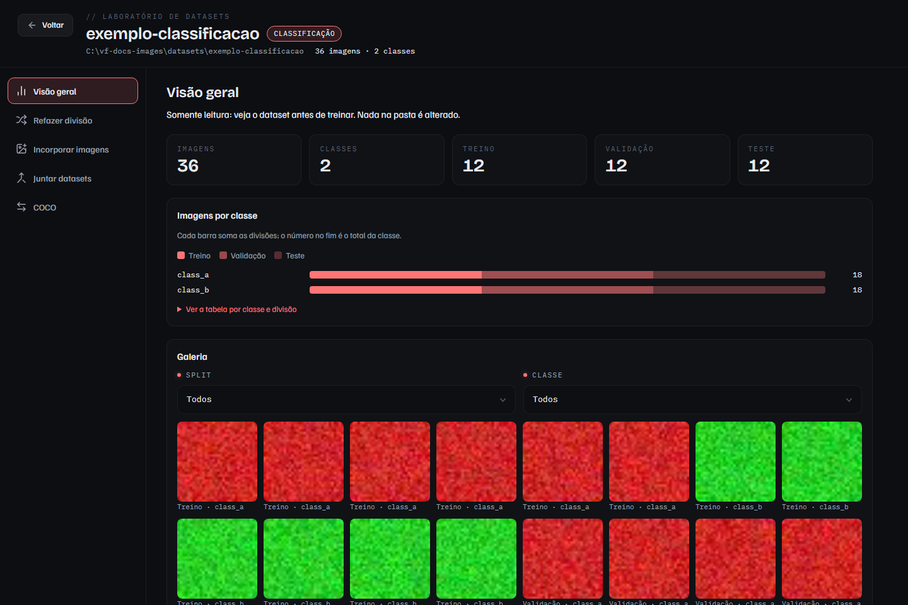

Na etapa Dados da classificação, **Auditar imagens** procura duplicatas
exatas, divisões vazias, imagens ilegíveis e, com um CSV de grupos, grupos em
mais de uma divisão. Como usar: [Datasets na interface](../gui/datasets.md).

## Configurar o treino

### Estratégias

A etapa **Estratégia** decide se o botão da barra roda um treino ou vários:
treino simples, K-fold, grid search, random search (ou sweep, conforme a
tarefa), réplicas e comparação replicada. Sob o seletor, a linha **Quando
usar** resume a situação em que a estratégia marcada serve.

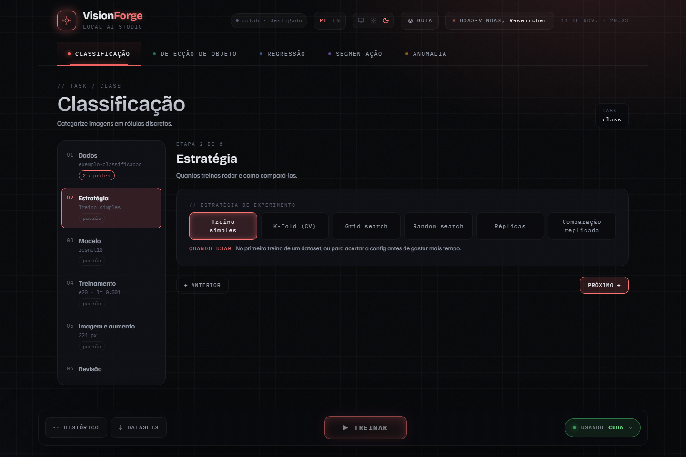

**Réplicas** treina a mesma configuração com N seeds e dá cada métrica em média
± IC 95%. A **comparação replicada** treina variantes nas mesmas seeds e aplica
um teste pareado com correção de Holm.

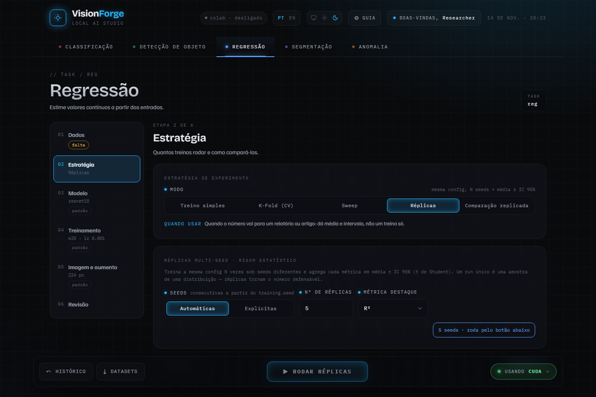

Como usar: [Estratégias](../gui/estrategias.md).

### Modelo e transfer learning

A etapa **Modelo** escolhe a arquitetura e de onde ela parte: pesos
pré-treinados, inicialização aleatória ou um checkpoint seu. O transfer
learning treina só o head (`feature_extraction`) ou head e backbone com
learning rates diferentes (`fine_tuning`).

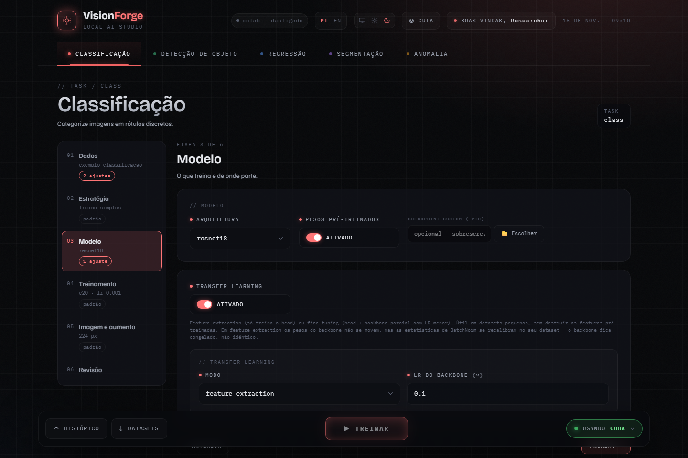

Como usar: [Modelo e transfer learning](../gui/modelo-e-transfer-learning.md).

### Imagem e aumento

A etapa **Imagem e aumento** define como cada imagem chega ao modelo: filtros
de pré-processamento (com **Ver preview**), tamanho, normalização e data
augmentation (com preview de aumento). Validação e teste nunca recebem aumento.

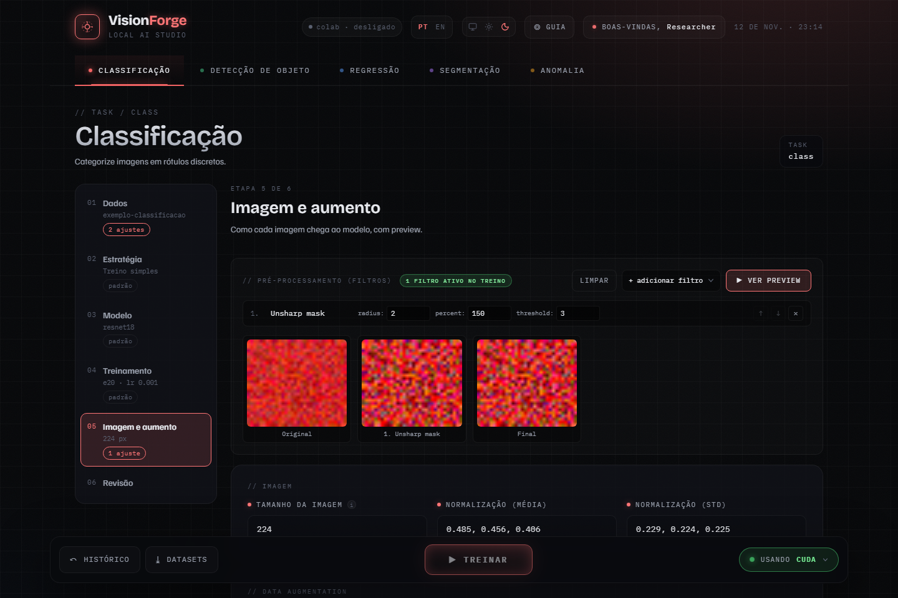

Como usar: [Imagem e aumento](../gui/imagem-e-aumento.md).

### Revisão

A etapa **Revisão** mostra tudo o que vai rodar, sugere o nome do experimento e
libera o botão **Treinar**. É também onde ficam exportar e importar a
configuração em YAML. Como o nome é montado:
[Nomes de experimentos](../gui/nomes-de-experimentos.md).

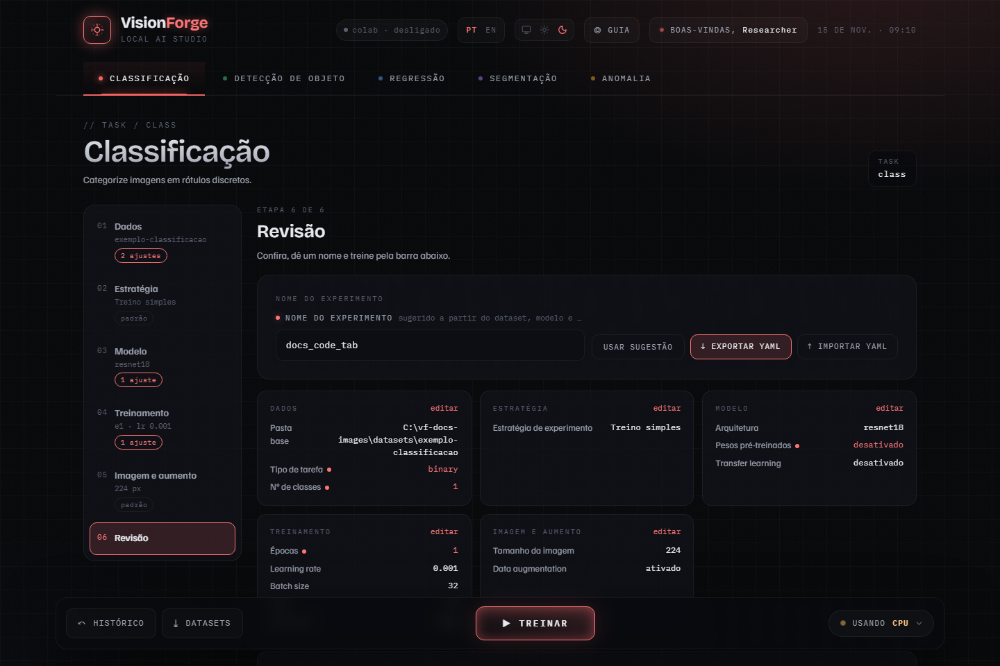

## Acompanhar o treino

**Treinar** abre o painel de treino. A aba **Log** mostra uma linha por época e
**Resultados** plota as curvas enquanto o treino roda. **Minimizar** devolve a
tela; o treino continua.

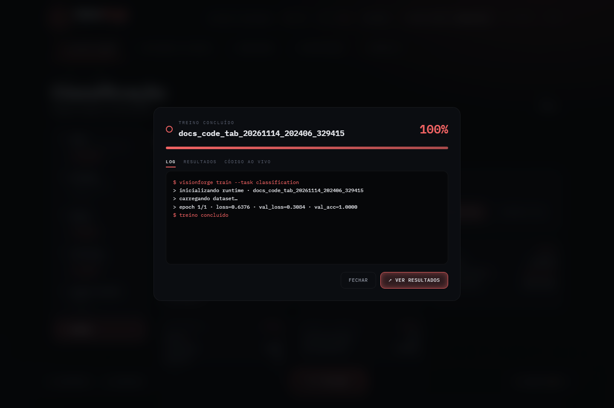

A aba **Código ao vivo** mostra o treino em passos (dados, modelo, loss, época
de treino, validação, teste e relatório) e o código real que o VisionForge
executa em cada um, lido do pacote instalado. O passo em execução fica marcado.

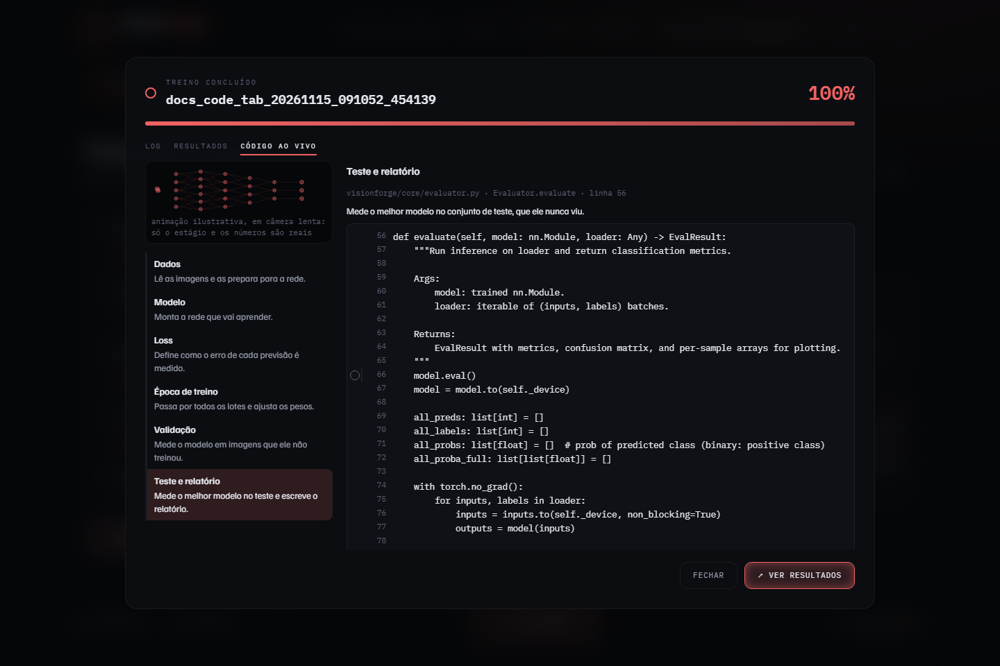

Como usar: [Aba Código](../gui/codigo.md).

## Ler e usar o resultado

**Ver resultados**, ao fim do treino, abre a execução no **Histórico**, com as
métricas, as curvas de treino e validação por época e os gráficos gravados
(matriz de confusão, curva ROC, curva Precision-Recall). Logo abaixo, o bloco
**E agora?** sugere no máximo dois próximos passos a partir do que a execução
registrou.

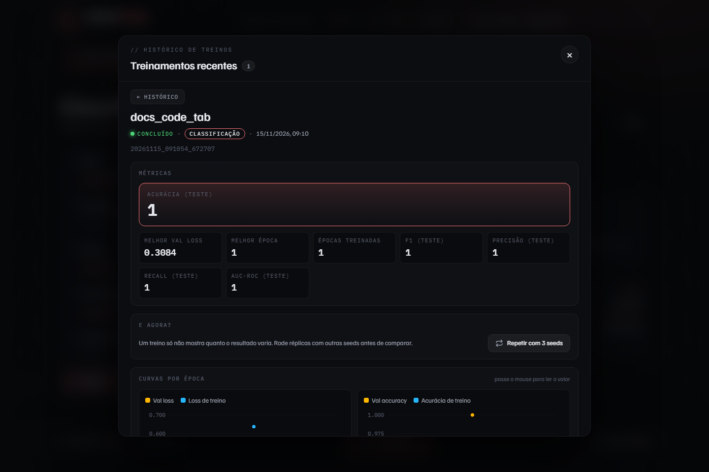

No detalhe da execução você:

- reabre a configuração (**Carregar no formulário**) ou repete com 3 seeds;
- baixa o **Bundle do experimento** ou o relatório em **Markdown**;
- usa **Exportar ONNX**, com comparação numérica contra o PyTorch e medida de
  latência;
- roda a **Inferência em lote** sobre uma pasta de imagens e recebe um CSV;
- gera mapas de calor **Grad-CAM** sobre imagens de exemplo.

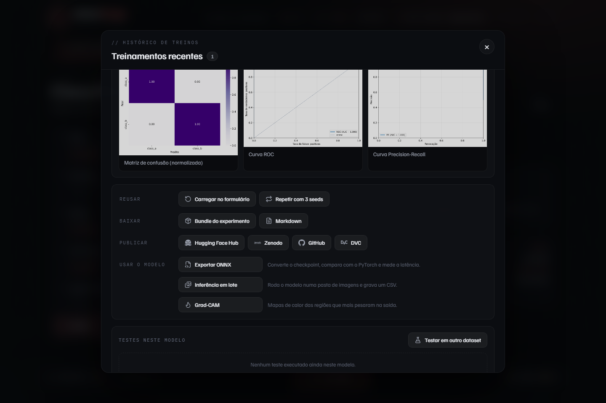

Para comparar ou excluir execuções, **Selecionar** marca várias; **Ranking**
ordena as execuções de cada dataset por uma métrica. Como usar:
[Depois do treino](../gui/depois-do-treino.md).

## Reproduzir

Cada execução grava em disco um `run.json` com a configuração, a seed, o
histórico por época, as métricas e o ambiente (versões de Python, torch e
demais bibliotecas, GPU, commit do git).

- Com `training.deterministic` ligado (o padrão), cada treino semeia Python,
  NumPy e PyTorch com a seed. Os números podem mudar entre GPUs e versões de
  PyTorch/CUDA.
- Na Revisão, **Exportar YAML** grava a configuração exata que a interface
  envia, e **Importar YAML** restaura o formulário.
- A linha de comando roda o mesmo arquivo: `visionforge run experimento.yaml`.
  As estratégias (réplicas, comparação, sweep, K-fold) também rodam assim.
- `visionforge bundle` e `visionforge verify-bundle` geram e conferem um ZIP
  com `run.json` e artefatos, com SHA-256 de cada arquivo.
- `visionforge reproduce` retreina uma semente desse ZIP e diz se o resultado
  cai dentro do intervalo de predição de 95% de uma semente, calculado das
  réplicas registradas.

Como usar: [`../REPRODUCIBILITY.md`](../REPRODUCIBILITY.md) e
[`../QUICKSTART.md`](../QUICKSTART.md).

## Registrar e publicar

Tudo é opcional e vem desligado. Os tokens ficam salvos por perfil
([Tokens](../gui/tokens.md)).

| Serviço | Para que serve | Como usar |
| --- | --- | --- |
| MLflow | comparar execuções num banco SQLite local, sem servidor nem conta | [MLflow](../gui/mlflow.md) |
| Weights & Biases | enviar os treinos a um projeto privado | [W&B](../gui/wandb.md) |
| Comet | enviar os treinos ao Comet | [Comet](../gui/comet.md) |
| Hugging Face Hub | enviar checkpoint, model card e métricas | [Hugging Face Hub](../gui/hugging-face-hub.md) |
| Zenodo | criar um rascunho com o bundle da execução | [Zenodo](../gui/zenodo.md) |
| GitHub | enviar o relatório a um repositório | [GitHub](../gui/github.md) |
| DVC | versionar a execução num repositório git deste computador | [DVC](../gui/dvc.md) |

MLflow, W&B e Comet se ativam em **Perfis**. Hugging Face Hub, Zenodo, GitHub e
DVC são botões do grupo **Publicar** no detalhe da execução.

## Treinar no Google Colab

Uma classificação pode treinar numa máquina do Colab, na sua conta Google. O
resultado volta ao Histórico como uma execução local, marcada com a origem
`colab`. O acesso fica no canto do Colab, no cabeçalho, e o dataset pode vir
de um endereço, de um provedor público ou do Google Drive.

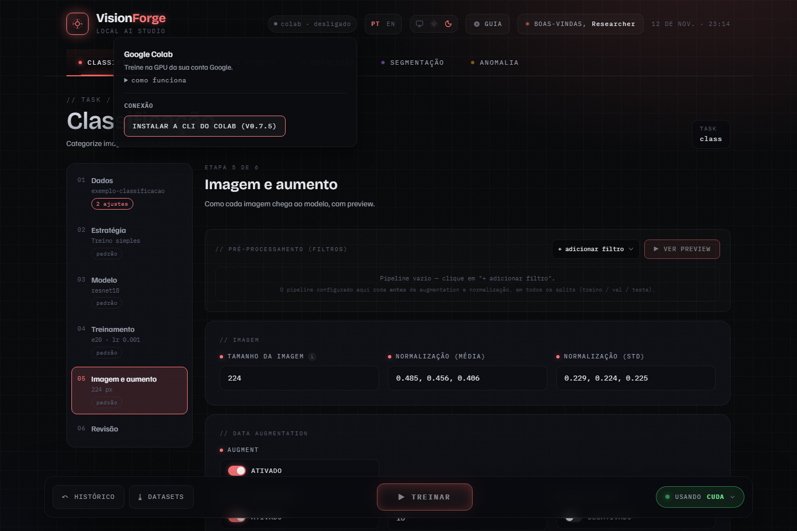

Como usar: [Colab](../gui/colab.md).

## Ajuda dentro da interface

O botão **guia**, no cabeçalho, tem três entradas. **Começando do zero** é uma
página para quem nunca treinou um modelo: os conceitos em oito capítulos, com
figuras, a gravação de um treino e onde estudar a área. O **Tour da interface**
e o **Primeiro treino** são roteiros que rodam sobre a própria tela. Ao lado de
cada campo, o **i** explica o que ele muda.

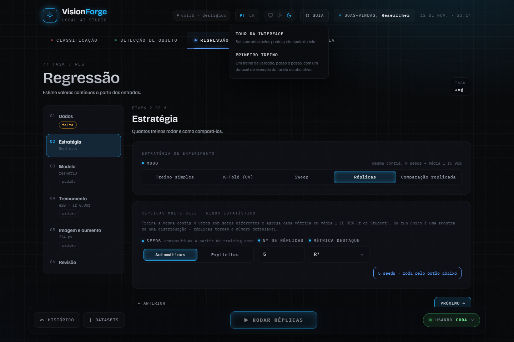

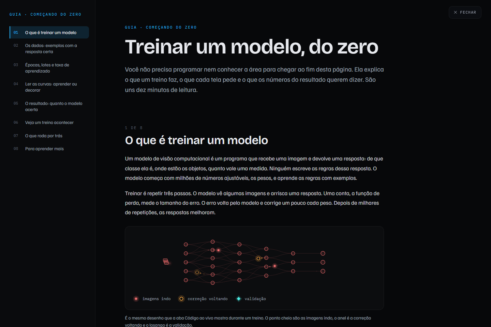

Como usar: [Começando do zero](comecando-do-zero.md), a mesma página em texto.

Índice das páginas: [Guias da interface](../gui/README.md).

## Estender

Dois pontos de extensão, sem alterar o pacote: o VisionForge carrega seu código
de `user_models/` e `user_tasks/`, ao lado de onde você o executa.

- **Modelo próprio**: usa a sua arquitetura em classificação, regressão ou
  segmentação ([Modelos](../custom/MODELS.md)).
- **Tarefa própria**: define uma família de tarefa inteira, com dados, loss e
  métricas seus. `visionforge new-task minha_tarefa` gera um esqueleto que já
  treina ([Tarefas](../custom/TASKS.md)).

Visão geral: [`../custom/README.md`](../custom/README.md).
